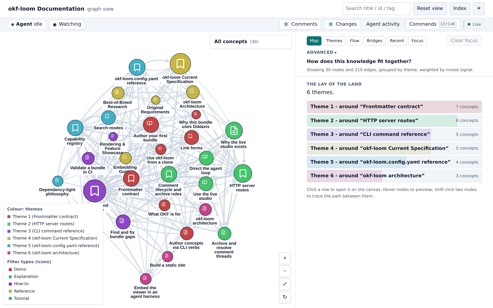
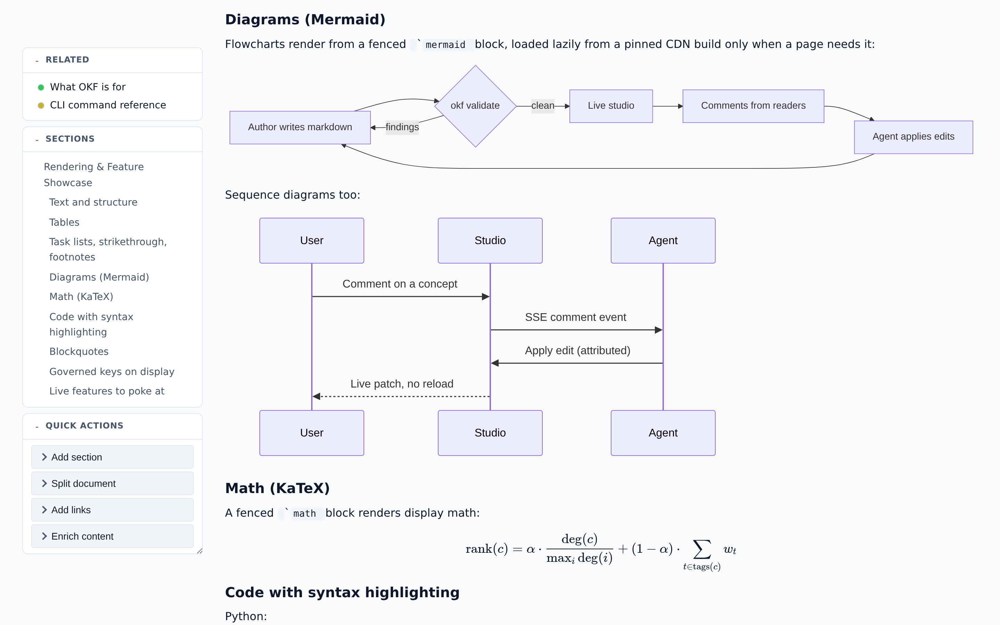
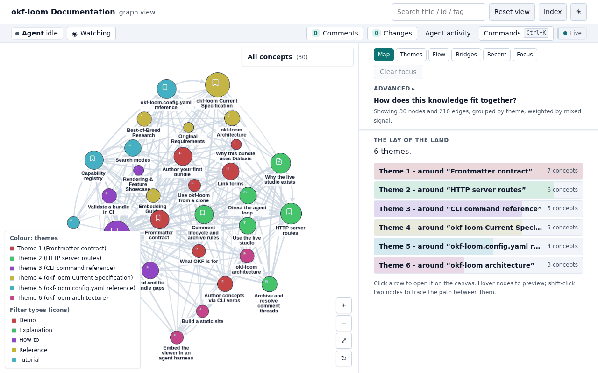
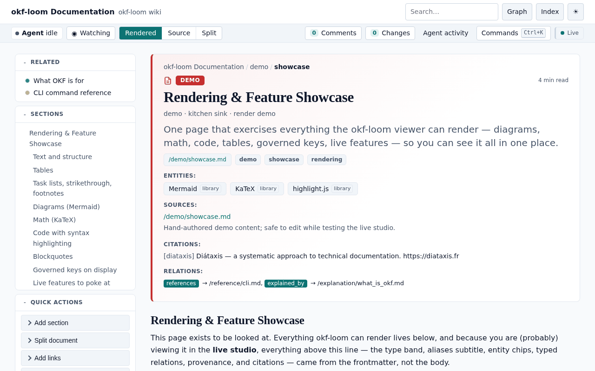
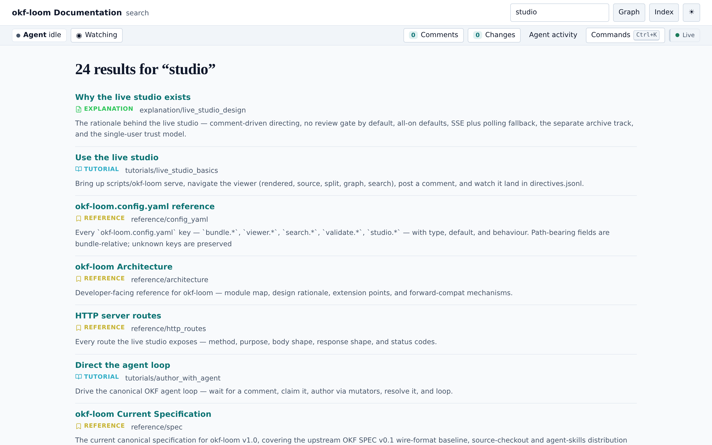

<div align="center">

# okf-loom

**A better agent + human experience for OKF knowledge trees. Serve any
folder of plain Markdown as a live studio: you read, explore, and drop
comments on any sentence — your agent picks them up and edits the files.
The files stay plain Markdown throughout.**

[](LICENSE)
[](docs-bundle/tutorials/install.md)
[](docs-bundle/explanation/zero_dependencies.md)
[](tests/)

**[▶ Upstream demo](https://ojamin.github.io/okf-loom/)** — an upstream static
build, not publication of this local fork or its current OKF 0.2 behavior.

</div>



okf-loom is a toolkit and loadable agent skill for
[Open Knowledge Format (OKF)](https://github.com/GoogleCloudPlatform/open-knowledge-format/blob/main/SPEC.md)
trees — knowledge kept as plain Markdown files with YAML frontmatter,
cross-linked into a graph. It adds the experience layer on top and
changes nothing underneath:

- **Your files stay plain OKF/Markdown — always.** No required database.
  Canonical authored concept content is
  one `.md` file with YAML frontmatter, readable on GitHub, greppable, and
  diffable. Dashboard, search, graph, and Context Pack surfaces are derived
  views, not additional authored sources of truth. Collaboration uses separate,
  versioned session state for comments, events, undo, and experimental proposals.
  Concept writes are atomic; writes routed through Studio are also attributed.
- **You get a studio, not a file browser.** A rendered wiki (Mermaid,
  KaTeX, code), an evidence-ranked graph with six lenses, and six search
  modes — live over your working tree, with zero install.
- **You and your agent get bounded evidence, not a file dump.** Search returns
  exact section passages, source lines, citations, and ranking reasons when a
  result has representable passage content; passage-less graph results remain
  explicit rather than fabricating evidence.
  Deterministic Context Packs fit that evidence to an explicit token budget.
- **Your agent gets a directable work queue.** Select any sentence and
  drop a note; your agent claims it, edits the files, and resolves it —
  and the page patches live in your browser while you keep reading.

## Quickstart

This git-loadable fork's supported local checkout is `ui-analysis`:
**okf-loom 2.0.0 implements OKF 0.2**. Use the provided checkout; a fork
publication URL has not been selected. The upstream demo is attribution, not
the installation source for this branch.

For this fork's current maintenance direction and the security/documentation
cleanup inventory, see the [fork-first maintenance plan](docs-bundle/explanation/maintenance_plan.md).

From the folder you want documented, give your agent one prompt:

```text
Use the supplied okf-loom checkout (supported branch: ui-analysis) and load
its SKILL.md. Start the live studio on ./docs (import or bootstrap
it as an OKF bundle first if it isn't one), give me the URL, then wait
for my comments and work each one to resolution.
```

Then the whole workflow is:

1. **Agent** serves the studio and blocks on the comment feed.
2. **You** open the URL and read your docs.
3. **You** select any sentence and type a note.
4. **Agent** claims it, edits the Markdown, resolves.
5. **You** watch the edit patch into the page live — keep reading, keep
   commenting.

Requirements: Python 3.11+, nothing to install. Add `--tunnel` to `serve`
for a shareable `https://…trycloudflare.com` link (needs `cloudflared`;
see [Sharing & security](#sharing--security)).


https://github.com/user-attachments/assets/76629b4f-ade1-4d60-9ac3-6e3394839282


## Tour

### Select text, leave a comment, let your agent do the work

Commenting is the studio's native editing gesture. Select any sentence
and a *Comment* button appears; the comment is anchored to that exact
text and lands in a queue your agent consumes:


While a studio is up, an agent runs the loop from the CLI — no plugins,
no webhooks:

```bash
scripts/okf-loom wait docs-bundle                     # blocks until a comment arrives
scripts/okf-loom comment-claim docs-bundle <id> --summary "what I will do"
# … edit via attributed, undoable mutators (write-concept, link-add, update…) …
scripts/okf-loom comment-resolve docs-bundle <id> --summary "what I did"
```

Edits broadcast live to every open tab over SSE — the page patches in
place, no reload. Comments, Changes (with group-undo) and Agent activity are
first-class panels in the top bar, and each says in one line what it answers.
A comment asks for work: it is saved on the bundle, and the agent picks it up
through the comment loop above (`wait` → `comment-claim` → `comment-resolve`);
Studio does not start an agent. The composer says whether a comment is pinned
to exact text or about the whole page.

### A wiki, not a file browser

Concept pages render a [supported Markdown subset](scripts/okf_loom/viewer/markdown.py), not full GitHub-flavoured
Markdown compatibility, plus Mermaid
diagrams, KaTeX math, and syntax-highlighted code. Frontmatter is not a
grey metadata dump: types become badges, entities become chips, typed
relations become navigable links, and citations and provenance are laid
out as a dressed header band.



The dashboard index shows bundle-level stats and per-area entry points;
[`docs-bundle/demo/showcase.md`](docs-bundle/demo/showcase.md) is one page
that exercises every renderer if you want to see the whole palette at once.

Bundle-local media renders inline too: keep screenshots, diagrams, video,
or PDFs in the bundle (e.g. an `assets/` dir) and ``
displays in the studio and in every build target — served under the same
visibility rules as concepts, sandboxed as user content, with `validate`
flagging any image whose file is missing.

### Six graph lenses, each answering one question

The graph is not a hairball generator. Each lens reshapes layout, colour,
and ranking to answer one question a reader actually has — **Map** (how
does this fit together?), **Themes** (what topic areas exist?), **Flow**
(what depends on what?), **Bridges** (which concepts hold the areas
together?), **Recent** (what is going stale?), and **Explore neighborhood**
(what surrounds the selected concept?). The side panel ranks the answers as
clickable evidence, not just pixels:



### Four theme families, light and dark

Technical is the conservative application default; Coffee remains an optional
family in advanced Appearance controls. Swiss, Technical,
Purple, and Coffee each render in light and dark, giving eight token-governed
themes plus Auto mode that follows the operating-system colour scheme.
Appearance also offers compact (default) and comfortable interface density
without changing prose measure or minimum control targets, and interface
borders start off (flat) until the reader turns them on. The test suite
enforces that every theme overrides the full token set, and the graph canvas
follows along:



### Search that understands the bundle

Six search modes behind one flag — BM25 lexical, fuzzy-semantic, hybrid
(rank fusion of the two), tag, entity, and relation — share one
dependency-light retrieval path with no model, embedding service, or database.
Results show one compact highlighted excerpt when exact passage evidence exists;
**Evidence and context** expands the complete source passage, `[path.md#Lx-Ly]`
citation, ranking reasons, and advanced actions. Passage-less graph results say
that they have graph evidence only and never expose **Copy passage**. Hybrid
evidence lists only the backends that actually contributed that result. Type,
tag, entity, and relation filters keep the result set focused. Use **Copy
passage** for the exact excerpt, **Copy concept context** for one concept, or
**Build context pack** for a bounded pack across the current Search URL:



Agents should request the same deterministic evidence instead of reading or
dumping arbitrary files:

```bash
scripts/okf-loom context docs-bundle "current spec" --mode hybrid \
  --budget-tokens 6000 --neighbors 1 --limit 20 --format markdown
scripts/okf-loom context docs-bundle --concept reference/spec --format json
```

Markdown is the default output and preserves exact excerpts with stable source
citations; JSON exposes the versioned context-pack contract. Context Packs do
not synthesize summaries or call a model. See the
[Context Packs reference](docs-bundle/reference/context_packs.md).

### Take it anywhere

The same bundle renders four ways: the live studio, a **static site**
(`build --target static` — the [upstream demo](https://ojamin.github.io/okf-loom/)
illustrates that target; this checkout retains a [Pages workflow](.github/workflows/pages.yml)),
a **SPA** build, and a **single `viz.html`** (`render`) you can attach to an
email. Renderer and graph libraries use pinned CDN assets by default, and
`serve` always does. Add `--assets offline` to `build` or `render` to ship
byte-verified copies instead: single-file offline output works from
`file://`, while static graph data and search, and SPA output as a whole,
still need HTTP serving. Offline output carries each library's licence and
the third-party notices (see [License](#license)). And because a bundle is
just Markdown, it still reads fine as plain files on GitHub.

Pages runs only on demand (**Deploy docs to Pages → Run workflow**); it has no
push trigger, is separate from the test workflows, and does not establish a
publication destination for this fork.

Live mode uses server-backed retrieval. Static and SPA builds with JavaScript
load a versioned, content-addressed passage corpus; the single-file viewer
embeds that corpus, so its output grows with the bundle. Static no-JS pages
remain browsable and expose canonical concept-only Markdown context, but
arbitrary search and query-built packs require JavaScript. Live no-JS GET
search and canonical Context Pack links remain available; SPA and single-file
views without JavaScript do not provide interactive retrieval.
This is the approved no-JavaScript contract: honest browse/concept-only
fallback or an explicit unavailable state. Arbitrary search and query-built
Context Packs require JavaScript or the live server.

## Built for agents from day one

This repo *is* a loadable skill. [`CLAUDE.md`](CLAUDE.md) (Claude Code),
[`AGENTS.md`](AGENTS.md) (opencode & friends), and [`SKILL.md`](SKILL.md)
(skill loaders) route any agent to the same standing contract:

1. **Author docs as OKF concepts** with fully-dressed frontmatter.
2. **Validate after writing** (`validate`, `discover`).
3. **Use bounded Context Packs** instead of dumping arbitrary files when an
   agent needs source-grounded bundle context.
4. **Serve the studio proactively** whenever a human wants to read or
   comment.
5. **Work the comment loop** (`wait` → `comment-claim` → mutators →
   `comment-resolve`).

So the setup for a team is: clone the repo, tell your agent to work in
it, open the studio, and start selecting text. The agent authors, links,
validates, and resolves; you read and direct.

## Everything is plain Markdown

A concept is one file. Frontmatter carries the metadata; Markdown links
are the graph edges. This is the entire storage format:

```markdown
---
type: reference
title: HTTP server routes
description: Every route the live studio exposes.
tags: [studio, http]
---

# HTTP server routes

The comment lifecycle is documented in
[Comment lifecycle](/reference/comment_lifecycle.md).
```

`type` is the only always-required key (OKF 0.2). Unknown keys are preserved
round-trip, hand-authored content is never destroyed, and every write
okf-loom makes is atomic and marker-safe. The binding contract for all of
this is [`docs-bundle/reference/spec.md`](docs-bundle/reference/spec.md).

OKF 0.2 adds optional sources, generation/verification, lifecycle, and Attested
Computation metadata. Trust tiers are advisory, never authorization. Computation
contracts are read, validated, and displayed — never executed. Legacy timestamps
and Loom citations remain readable; imports do not fabricate their producers.
See the [0.2 example](docs-bundle/demo/okf02_computation.md) and
[conservative migration guide](docs-bundle/how-to/migrate_spec_version.md).
Preview/check write nothing; applying is explicit, may report partial completion,
and is atomic per file rather than a bundle-wide transaction.

## Common commands

```bash
# Validate and inspect.
scripts/okf-loom validate docs-bundle --strict
scripts/okf-loom info docs-bundle

# Search, build bounded agent context, and discover gaps.
scripts/okf-loom search docs-bundle "current spec" --mode hybrid
scripts/okf-loom context docs-bundle "current spec" --mode hybrid \
    --budget-tokens 6000 --neighbors 1 --limit 20 --format markdown
scripts/okf-loom discover docs-bundle --out /tmp/okf-suggestions.json

# Serve live, or build artifacts.
scripts/okf-loom serve docs-bundle --no-open            # live studio
scripts/okf-loom build docs-bundle --target static --out /tmp/site
scripts/okf-loom render docs-bundle --out /tmp/viz.html # single file

# Author safely (attributed, undoable, broadcast live).
scripts/okf-loom bootstrap path/to/new-bundle
scripts/okf-loom write-concept --bundle path/to/bundle --id notes/decision \
    --type decision --title "Use SQLite" --body "## Context ..."
scripts/okf-loom link-add --bundle path/to/bundle --source tables/orders --target tables/customers
scripts/okf-loom update-section --bundle path/to/bundle --id notes/decision \
    --heading "## Context" --body-file /tmp/new-context.md   # swap one block, keep the rest
```

Run `scripts/okf-loom --help` for the full verb list (25+ commands), or
read the [CLI reference](docs-bundle/reference/cli.md).

## Sharing & security

`serve` binds `127.0.0.1:8787` — loopback-only — by default. `--tunnel`
creates a public Cloudflare URL through dedicated ingress; public access is
read-only by default and does not widen local/admin allow-lists. For
user-authored comments and replies only, use `--allow-tunnel-comment` on
`serve --tunnel` or `tunnel`. This mutually exclusive alternative grants no
content edits, comment-row updates, presence, agent, proposal, or admin
powers. Add `--allow-tunnel-edit` only when every URL holder may receive
separate, generation-scoped authority for comment/content mutations; it never grants
local admin or session-control authority. `--public --public-ack` remains the
separate raw-network-bind choice. Already serving? Attach the same
read-only-by-default tunnel with `scripts/okf-loom tunnel <bundle>`
(`--allow-tunnel-edit` is the same dangerous opt-in; `--stop` detaches) — no
restart needed. Use `--no-edit` to disable bundle mutations across the studio.
Details: [SECURITY.md](SECURITY.md) and the
[HTTP routes reference](docs-bundle/reference/http_routes.md).

## Skill resources

| File | Purpose |
|---|---|
| [`resources/overview.md`](resources/overview.md) | OKF purpose and trigger list |
| [`resources/command-reference.md`](resources/command-reference.md) | Invocation and CLI flows |
| [`resources/format-basics.md`](resources/format-basics.md) | Bundles, concepts, frontmatter, links |
| [`resources/authoring.md`](resources/authoring.md) | Curation conventions and mutators |
| [`resources/validation.md`](resources/validation.md) | Validation profiles and fail-closed behavior |
| [`resources/advanced-operations.md`](resources/advanced-operations.md) | Search, discovery, build, capabilities |
| [`resources/studio-agent-loop.md`](resources/studio-agent-loop.md) | Live studio comment loop |
| [`resources/architecture-map.md`](resources/architecture-map.md) | Runtime/source map |
| [`resources/gotchas.md`](resources/gotchas.md) | Hard rules and traps |

The full documentation lives as an OKF bundle in
[`docs-bundle/`](docs-bundle/) — okf-loom is documented in okf-loom.
The [gold-standard 2026 design and release record](docs/design/gold-standard-2026.md)
captures the capability audit, decisions, proof, performance costs, and
remaining limitations behind that historical retrieval tranche. The
[maintenance plan](docs-bundle/explanation/maintenance_plan.md) owns current priorities.

## Repository layout

```text
okf-loom/
├── SKILL.md                  # primary skill entrypoint for agents
├── CLAUDE.md / AGENTS.md     # thin pointers that route agents to SKILL.md
├── README.md                 # this file
├── resources/                # small agent-readable guidance files
├── scripts/
│   ├── okf-loom              # the checked-in helper command
│   ├── okf_loom/             # checkout-local runtime (stdlib-only)
│   ├── capture_readme_media.py   # regenerates docs/media/
│   ├── capture_viewer_proof.py
│   ├── capture_signal_controls.py
│   ├── build_skill_archive.py
│   └── lint-js.sh
├── docs-bundle/              # okf-loom's own docs, as an OKF bundle
├── samples/                  # example bundles (demo_bundle, showcase)
├── docs/                     # screenshots, README media, design notes
└── tests/                    # pytest regression suite
```

The distribution unit is this git repo layout; `pyproject.toml` exists
only for pytest/coverage configuration.

## Developer tests

Runtime use still needs no install. For the developer baseline on Linux, use
Python **3.11 or 3.12**, Git, and **Node 22.22.1** (Node runs portable retrieval
parity and JavaScript syntax/logic checks; it is not an npm installation).
The on-demand **Developer tests** workflow tests both Python versions
independently of Pages deployment.

```bash
python3 -m venv .venv
. .venv/bin/activate
python -m pip install -r requirements-dev.txt
export PYTHONDONTWRITEBYTECODE=1 PYTEST_DISABLE_PLUGIN_AUTOLOAD=1
python -m pytest -q -p no:cacheprovider -m "not browser and not integration"
```

That is the core invocation: it collects without importing Playwright and runs
local HTTP, persistence, capture-validator, retrieval and proposal runtime-identity
proofs. Only real browser tests and optional external upstream-bundle integration
are deselected; no historical evidence is regenerated. Fixtures that serve shipped
bundles use disposable copies. Pytest temporary directories may be relocated with
`TMPDIR=/tmp`. Pinned developer requirements include the active Linux dependency
closure; the unused package-free `uv.lock` was removed rather than implying a
Python 3.12 runtime minimum. There is no `uv sync` or editable-install step.

The focused fallback lane is also part of the **Developer tests** workflow, which
runs only on demand (**Developer tests → Run workflow**):

```bash
OKF_LOOM_FORCE_BUILTIN_YAML=1 python -m pytest -q -p no:cacheprovider \
  tests/test_yaml_fallback.py tests/test_bootstrap_import.py
scripts/okf-loom validate docs-bundle --strict
```

For browser work, provision the separate optional tools explicitly:

```bash
python -m pip install -r requirements-browser.txt
python -m playwright install --with-deps chromium
OKF_REQUIRE_BROWSER=1 python -m pytest -q -p no:cacheprovider -m browser \
  tests/test_document_outline_browser.py tests/test_a11y_reflow_browser.py
```

That manual lane is available through **Developer tests → Run workflow →
browser**. Separately, the **Browser smoke** workflow
(`.github/workflows/browser-smoke.yml`) runs only on demand (**Browser smoke →
Run workflow**); its automatic pull-request and push triggers are turned off.
It provisions Chromium the same way with `OKF_REQUIRE_BROWSER=1`, so a missing
browser fails the job instead of skipping, and runs five short journeys, one
existing test each, as separately named steps: shell and capability truth;
search to a document and Back restoring the query; comment, reply, agent
mutation and resolution; portable feedback import; and document patch with the
outline lifecycle. A failing step names its journey and its pytest node id,
which reproduces it locally. Neither lane is a full browser/accessibility or
release gate; the full browser suite stays manual.
Other browser-marked modules can be selected explicitly for the affected surface;
some require CDN access or headed Chrome/browser-owned zoom. Without
`OKF_REQUIRE_BROWSER=1`, absent Playwright or a missing browser may skip; broken
imports, browser launch errors, and product startup failures are errors, not
absence. The shared server fixture includes startup log diagnostics and bounded
terminate/kill cleanup. `OKF_CHROME` (or `AIC_PLAYWRIGHT_CHROME_PATH`) selects an
explicit installed executable; a bad configured path fails. Otherwise fixtures
prefer managed Chromium, then an installed Chrome/Chromium. The legacy explicit
`OKF_BROWSER_TEST_OPT_OUT=1` remains available but conflicts with required-browser
mode. Use marker selection for core runs. A test that starts Playwright or
Chromium through `tests/browser_support.py` without the `browser` marker fails
with an error naming it; `tests/test_browser_marker_guard.py` proves this
without starting a browser.

**Browser and accessibility coverage limits.** Automated browser checks run on
Chromium only, driven by Playwright 1.58.0 (managed Chromium in CI; locally,
whichever Chromium or Chrome the fixtures select). `tests/test_a11y_reflow_browser.py`
checks reflow at 200% and 400% with CSS-viewport equivalents (720×450 at DPR 2,
and 320×256 at DPR 4). These reproduce the layout viewport that WCAG 1.4.10 is
defined in, but they are not browser-owned zoom. Real page zoom is checked only
by opt-in proofs in headed Chrome: `OKF_TEST_HEADED_ZOOM=1` runs the
`HEADED_ZOOM_TESTS` in `tests/test_ui_reflow_nojs_remediation.py` with
`OKF_CAPTURE_REAL_BROWSER_ZOOM=1`, pressing Ctrl+plus through `xdotool`, so they
need `DISPLAY` and `xdotool` (see `tests/browser_zoom.py`); they are not part of
CI. Text-only zoom and custom browser font sizes are not tested. Accessibility
semantics are checked against Playwright's ARIA snapshot and Chromium's
accessibility tree. No screen reader has been run (NVDA, JAWS, VoiceOver, Orca or
TalkBack), so spoken wording, live-region timing and virtual-cursor behaviour are
unverified. Firefox, Safari/WebKit and mobile browsers are not tested, and no
automated rule engine such as axe-core is used. Treat these checks as regression
guards, not a claim of accessibility conformance.

Historical release verification remains an explicit, selected-source operation;
see [ordinary regression versus release evidence](docs-bundle/reference/spec.md#ordinary-regression-versus-selected-release-evidence).
Passing core or browser smoke does not promote stored evidence or certify release
readiness.

## Regenerating media & browser proof

The screenshots and GIFs on this page live in [`docs/media/`](docs/media/)
and are reproducible from a live studio. Use the developer/browser setup above;
Pillow is additionally needed only for media/GIF assembly:

```bash
python -m pip install pillow

PYTHONPATH=scripts python scripts/capture_readme_media.py   # this page's media
PYTHONPATH=scripts python scripts/capture_viewer_proof.py   # dated spec §17 proofs
OKF_REQUIRE_BROWSER=1 python -m pytest tests/test_viewer_browser.py -m browser
```

The capture helpers use the viewer's production readiness owner rather than a
fixed sleep or canvas-attachment heuristic. One 30-second monotonic budget
covers navigation, semantic readiness, the paint boundary, and screenshot
publication. PNG and JPEG outputs are published atomically. Chrome resolution
is shared across the helpers: `--chrome`, then `OKF_CHROME`, then
`AIC_PLAYWRIGHT_CHROME_PATH`, known system Chrome paths, the Chrome channel,
and finally managed Playwright Chromium.

Each capture invocation owns a unique same-directory temporary and only the
current cross-process destination sequence may replace the destination;
managed late workers cannot recreate an orphan temp or final artifact. Failed
or late work preserves the previous artifact. README GIF assembly uses
invocation-private frame staging and the same verify/close/atomic-replace
envelope. Capture phases preserve caller-owned one-shot and recurring timers.
Synchronous Playwright work stays on its owning main thread; off-main calls
fail before creating workers or artifacts. Partial live/static server startup
is cleaned up before an error escapes.
Inherited ignored one-shot and periodic alarms remain ignored without masking
the capture deadline.

Maintainers can run `python scripts/benchmark_gold_standard.py --help` for the
separate release benchmark harness. It defaults to 100 and 1,000 concepts;
sizes above 1,000 require `--large-scales`, static builds require
`--static-build`, and large static builds require both. These are maintainer
tools, not `scripts/okf-loom` primary CLI commands.

## License

okf-loom is licensed under the Apache License, Version 2.0 — commercial
and non-commercial use are both allowed. See [LICENSE](LICENSE) and
[CONTRIBUTING.md](CONTRIBUTING.md).

`scripts/okf_loom/viewer/vendor/` holds unmodified third-party libraries
(Mermaid, KaTeX, highlight.js, Cytoscape.js and its layout extensions) under
their own licences (MIT or BSD-3-Clause; the KaTeX fonts are under the SIL
Open Font License 1.1, and the components bundled inside those libraries are
listed separately). Only `--assets offline` output ships them, together with
their licences; see
[`THIRD-PARTY-NOTICES.txt`](scripts/okf_loom/viewer/vendor/THIRD-PARTY-NOTICES.txt)
and
[`BUNDLED-DEPENDENCY-NOTICES.txt`](scripts/okf_loom/viewer/vendor/BUNDLED-DEPENDENCY-NOTICES.txt).
Keep those files, and each library's `LICENSE`, when you redistribute offline
output or the vendored folder.

okf-loom is compatible with and complementary to the upstream OKF
specification (also Apache-2.0). This implementation is independent; it
is not affiliated with or endorsed by Google.
