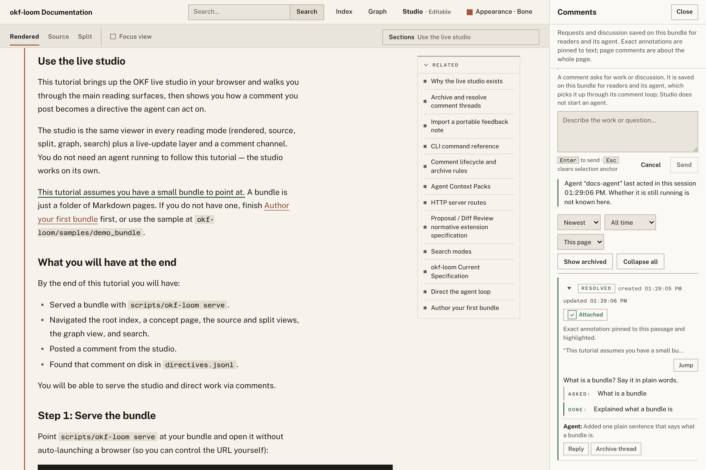
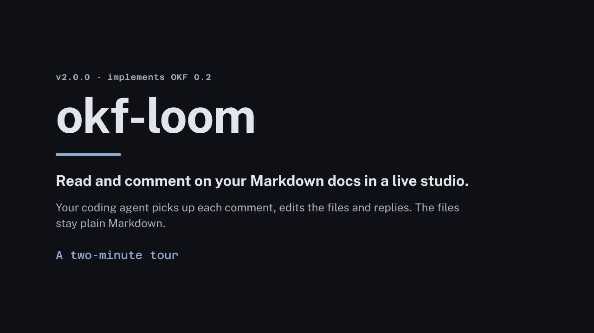
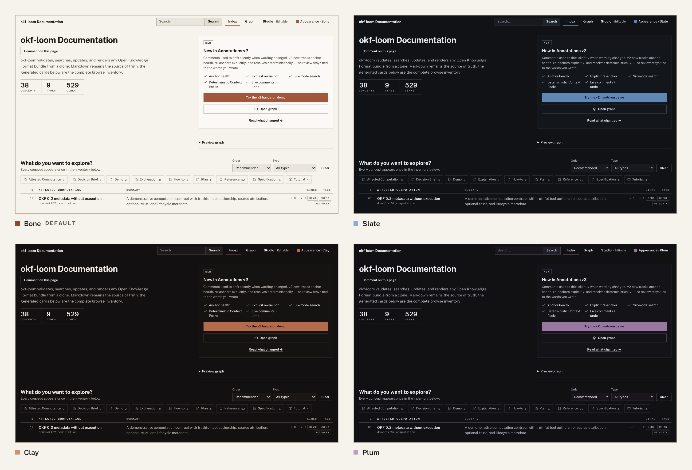
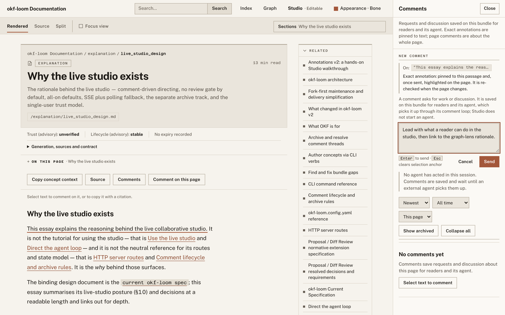
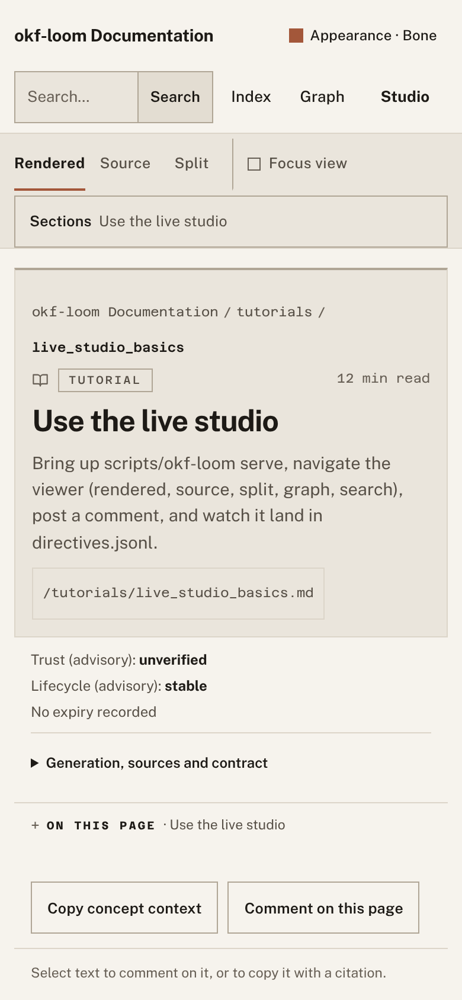
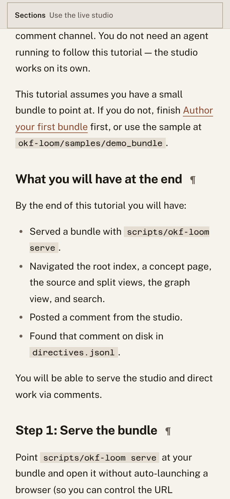

<div align="center">

# okf-loom v2

**Read, explore and comment on a folder of Markdown in a live studio while
your coding agent does the editing. The files stay plain Markdown
throughout.**

[](LICENSE)
[](docs-bundle/tutorials/install.md)
[](docs-bundle/explanation/zero_dependencies.md)
[](docs-bundle/reference/spec.md)

</div>

<picture>
  <source media="(prefers-color-scheme: dark)" srcset="docs/media/hero-dark.png">
  
</picture>

okf-loom is a toolkit and loadable agent skill for
[Open Knowledge Format (OKF)](https://github.com/GoogleCloudPlatform/open-knowledge-format/blob/main/SPEC.md)
bundles: documentation or knowledge kept as plain Markdown files with YAML
frontmatter, linked into a graph. It validates, searches, renders and edits
those bundles, and serves them as a live Studio. You read and comment on any
page or sentence; your agent picks the comments up, edits the files and
resolves them while the page updates in your browser.

It is for people who keep docs or a knowledge base in Markdown and work on it
with a coding agent: Claude Code, opencode, or any harness that can load a
skill and run shell commands. There is no database and nothing to install.
Clone the repository and run `scripts/okf-loom`.

okf-loom v2 is maintained by [SpatialNexus](https://github.com/SpatialNexus).
It is a fork of [okf-loom v1](https://github.com/ojamin/okf-loom) by
[ojamin](https://github.com/ojamin), who created okf-loom and wrote the v1
that v2 builds on; see [Credits](#credits).

## Quick start

You need Python 3.11 or newer and Git.

**With your agent.** From the folder you want documented, give your agent one
prompt:

```text
Clone https://github.com/SpatialNexus/okf-loom-v2 into ./okf-loom and load
okf-loom/SKILL.md. Start the live studio on ./docs (import or bootstrap it as
an OKF bundle first if it isn't one), give me the URL, then wait for my
comments and work each one to resolution.
```

Then the whole workflow is:

1. **Agent** serves the studio and waits for comments.
2. **You** open the URL and read your docs.
3. **You** select any sentence, or use **Comment on this page**, and type a
   note.
4. **Agent** claims the comment, edits the Markdown and resolves it with a
   reply.
5. **You** watch the page update live and keep reading.

**By hand.** Try it on okf-loom's own documentation:

```bash
git clone https://github.com/SpatialNexus/okf-loom-v2 okf-loom
cd okf-loom
scripts/okf-loom validate docs-bundle --strict
scripts/okf-loom serve docs-bundle        # opens http://127.0.0.1:8787/
```

`serve` listens only on your own machine. Add `--tunnel` for a shareable
`https://…trycloudflare.com` link (needs `cloudflared`; the link is read-only
unless you opt in, see [Sharing and security](#sharing-and-security)).

## See it in action

### The two-minute tour

<!-- To show an inline player here: edit this README on github.com, drag
docs/media/walkthrough.mp4 into the editor in place of the linked poster
image below, and keep the description paragraph under it. -->

[](docs/media/walkthrough.mp4)

[Watch the tour](docs/media/walkthrough.mp4) (2 min, MP4): the home inventory,
reading and source views, a comment worked to resolution by an agent, cited
search, the command palette, the graph and the four palettes, in one take.

### Comment, and your agent does the work


Select a sentence and leave a comment. Your agent's `wait` picks it up, then
it claims the comment, edits the Markdown (the page updates live) and resolves
the thread with a reply. [Watch the MP4](docs/media/comment-loop.mp4) (31 s).

### Restyle the studio from one menu


One Appearance menu applies Ledger live: **Bone** (the light default), **Slate**,
**Clay**, **Plum**, or **System** (Bone in OS light mode, Slate in dark mode).
Public Sans and Azeret Mono are self-hosted, including offline and single-file
output. [Watch the MP4](docs/media/appearance.mp4) (17 s).

### Explore the bundle as a graph


Find concepts by title, id or tag, switch lenses to reframe the same bundle,
hover a concept to preview it and double-click to open its page.
[Watch the MP4](docs/media/graph.mp4) (23 s).

### Search with citations, and jump anywhere


Search as you type in the header, then open the full results: each one shows
the exact passage it matched, with a `[path.md#Lx-Ly]` citation and the reason
it ranked. Press `Ctrl+K` to open the command palette and jump straight to a
page. [Watch the MP4](docs/media/search.mp4) (15 s).

### Screenshots

**Studio home.** The bundle's front page: its title and purpose, counts of
concepts, types and links, and one browsable inventory of every concept,
grouped by type in ruled rows.


**Palettes.** The same home in Bone, Slate, Clay and Plum. Content types are
not colour-coded, so the structure reads the same in every palette.



**Comments.** Select text and the composer pins the comment to that exact
passage, or comment on the whole page.



**Rendering.** Mermaid diagrams, KaTeX math and highlighted code render in the
page. [`docs-bundle/demo/showcase.md`](docs-bundle/demo/showcase.md) uses every
renderer on one page; here in Focus view, which widens the workspace.


**Search.** Every result shows the passage it matched, and its evidence gives
the exact source lines and the methods that ranked it.


**Graph, dark mode.** The Bridges lens ranks the concepts that connect the
bundle's topic areas. Hovering one lights up its connections.


**Phone.** The top bar and view tabs fit above the page. Scroll down and they
slide away, leaving only the Sections row pinned; scroll up to bring them back.

<p>


</p>

## What's new in v2

v2 builds on [okf-loom v1.0.0](https://github.com/ojamin/okf-loom). The
[CHANGELOG](CHANGELOG.md) has the full list, breaking changes and migration
notes; [What changed in okf-loom v2](docs-bundle/explanation/v2_release_notes.md)
explains the larger changes.

**OKF 0.2**

- okf-loom 2.0.0 implements OKF 0.2 (v1 implemented OKF 0.1). `type` is still
  the only required key. The new optional provenance (`generated`,
  `verified`, `sources`), lifecycle (`status`, `stale_after`) and Attested
  Computation metadata are validated and shown as advisory badges. Trust is
  never treated as authorization, and computations are never run.
- `scripts/okf-loom upgrade` migrates OKF 0.1 bundles conservatively. Preview
  and check write nothing; `--apply` is explicit, keeps legacy timestamps and
  authored text, and records who produced existing content only when you name
  them with `--actor`. See the
  [migration guide](docs-bundle/how-to/migrate_spec_version.md).

**Live Studio**

- **Comment on this page** adds whole-page comments alongside comments pinned
  to exact text. Agents can ask a question in the thread with
  `comment-reply` without resolving it.
- Edit one block at a time with `update-section` and `replace-text`; both
  refuse a missing or ambiguous target.
- `scripts/okf-loom tunnel` shares a running Studio, or stops sharing it,
  without a restart. Public links are read-only by default; add
  `--allow-tunnel-comment` for comment-only sharing or `--allow-tunnel-edit`
  for full edits.
- Feedback from exports: static and single-file builds can include an offline
  note composer (`--include-portable-feedback`). Readers download a note, and
  you import it into your local Studio as a page comment. Exports can also
  link back to your Studio (**Review in Studio**, set by
  `viewer.review_base_url`).
- Experimental proposal review: `scripts/okf-loom proposal` and
  `serve --enable-proposal-review`, with an opt-in, inspection-only Proposals
  panel. Direct editing stays the default.

**Anchoring and annotations**

- Exact comments are re-checked against the current text and report their
  health (resolved, stale, ambiguous or invalid) instead of drifting when
  the wording changes. **Re-anchor** moves a comment to new wording
  explicitly.
- The composer says whether a comment is an exact annotation or a page
  comment.

**Appearance**

- Ledger replaces the old families with Bone, Slate, Clay and Plum, plus System.
  Bone is the default; a saved reader choice overrides bundle configuration.
- Square geometry, ruled inventory rows, tabular mono figures and one accent
  keep structure consistent across palettes. Content types are not colour-coded.
- Code wells stay dark in every palette. The reading column is 760px with
  16px/1.72 prose capped at 55ch; Focus expands the workspace, not prose measure.
- Contrast, border and density modifiers are retired. Public Sans and Azeret
  Mono (normal and italic) ship locally under SIL OFL 1.1.

**Graph**

- The six lenses (Map, Themes, Flow, Bridges, Recent, and Explore
  neighborhood, which is v1's Focus lens renamed) sit under one
  **Explore with lenses** panel.
- **Find in graph** looks concepts up by title, id or tag; the viewport
  controls gain full screen; and spacing, layout and relationship-label
  options are grouped under **Graph settings**.
- Keyboard users can trace the path between two concepts with Shift+Space,
  and an optional 45-second tour introduces the view.
- `scripts/okf-loom graph-quality` reports advisory graph-health signals.

**Search and Context Packs**

- Search results show the exact matching passage with a `[path.md#Lx-Ly]`
  citation and the reasons it ranked, and can be filtered by type, tag,
  entity or relation.
- `scripts/okf-loom context` builds deterministic, citation-ready Context
  Packs within a token budget, with no model and no generated summaries.
  See the [Context Packs reference](docs-bundle/reference/context_packs.md).
- Static, SPA and single-file builds run all six search modes and build
  Context Packs in the browser, from a content-addressed passage corpus.
- `discover` groups suggestions by how safe they are to apply and supports
  suppressions.

**Builds and distribution**

- `--assets offline` for `build` and `render` ships verified copies of the
  renderer and graph libraries with their licences; a single-file offline
  build works straight from disk.
- `build --output-policy managed` (static and SPA) records what it wrote and
  refuses to replace files it did not produce.
- Images, video and PDFs kept in the bundle are served by the Studio and
  copied into static and SPA builds, and `validate` warns about missing
  images.
- `scripts/build_skill_archive.py` builds the skill zip from a Git commit
  rather than the working tree; `--verify` checks an existing archive.

## Upgrading from v1

v2 is a drop-in replacement for okf-loom v1.0.0. It lives in its own
repository, [SpatialNexus/okf-loom-v2](https://github.com/SpatialNexus/okf-loom-v2),
with the same `scripts/okf-loom` entry point, and no command or flag was
removed. OKF 0.1 bundles validate unchanged, and v1 Studio session state
(comments and presence) carries over. What to expect:

- **OKF 0.2 is optional.** `scripts/okf-loom upgrade <bundle>` only previews;
  the [migration guide](docs-bundle/how-to/migrate_spec_version.md) covers
  applying it.
- **Themes.** Old names still load: all old light variants (including v1
  `light`, `pastel`, `sepia`) → Bone; Technical/Swiss dark (including `dark`,
  `midnight`) → Slate; Coffee dark → Clay; Purple dark → Plum; `auto` → System.
  Prefer `bone|slate|clay|plum|system` in `studio.theme` or viewer `theme`.
  Browser choices migrate once to `okf-loom.appearance`; retired modifier keys
  are ignored. Saved choice > configured choice > Bone; reset returns to the
  configured choice. See [migration notes](CHANGELOG.md#unreleased).
- **Index links.** Your first `index` run rewrites the links in generated
  index blocks from relative (`orders.md`) to bundle-absolute
  (`/datasets/orders.md`), a one-time diff. On GitHub a leading `/` resolves
  from the repository root, so these links only work there for a bundle at
  the root.
- **Lock files.** v2 creates lock files inside bundles; add them to your
  `.gitignore` (`<bundle>/.okf-loom/session/` already ignores itself):

  ```gitignore
  .okf-loom-bundle.lock
  *.okf-lock
  ```

- **`status:` is lifecycle.** Its values are `draft`, `stable` (the default)
  and `deprecated`; anything else, such as `status: accepted`, warns
  `concept.bad_status` (failing `validate --strict`). Keep domain states under a key of your own, such as
  `decision_status:` (unknown keys are preserved).
- **New defaults.** `write-concept` adds `generated` frontmatter
  (`--no-defaults` omits it), and tunnel links are read-only unless you add
  `--allow-tunnel-comment` or `--allow-tunnel-edit`.

The [CHANGELOG](CHANGELOG.md) lists every breaking change and migration note.

## View the docs locally

okf-loom documents itself: [`docs-bundle/`](docs-bundle/) is an OKF bundle.
v2 has no hosted docs site, so view it one of these ways:

```bash
# Live Studio: read, search, explore the graph and comment.
scripts/okf-loom serve docs-bundle                 # http://127.0.0.1:8787/

# Static site. Its graph and search load data files, so serve it over HTTP.
scripts/okf-loom build docs-bundle --target static --out /tmp/okf-docs-site
python3 -m http.server 8000 --directory /tmp/okf-docs-site

# One self-contained HTML file; --assets offline embeds the libraries too.
scripts/okf-loom render docs-bundle --assets offline --out /tmp/okf-docs.html
```

Because a bundle is just Markdown, it also reads fine as plain files on
GitHub. Start at [`docs-bundle/index.md`](docs-bundle/index.md).

## Everything is plain Markdown

A concept is one file. Frontmatter carries the metadata; Markdown links are
the graph edges:

```markdown
---
type: reference
title: HTTP server routes
description: Every route the live studio exposes.
tags: [studio, http]
---

# HTTP server routes

The comment lifecycle is documented in
[Comment lifecycle](/reference/comment_lifecycle.md).
```

`type` is the only always-required key. Unknown keys are preserved, authored
content is never overwritten, and every write okf-loom makes is atomic.
Dashboards, search, the graph and Context Packs are views derived from those
files. Comments, activity, undo history and proposals live in a separate
session folder inside the bundle (`.okf-loom/`), never in your Markdown.

The binding contract is the
[okf-loom specification](docs-bundle/reference/spec.md). The page renderer
supports a [subset of Markdown](scripts/okf_loom/viewer/markdown.py) rather
than full GitHub-flavoured Markdown.

## Built for agents

This repository *is* a loadable skill. [`CLAUDE.md`](CLAUDE.md) (Claude
Code), [`AGENTS.md`](AGENTS.md) (opencode and similar) and
[`SKILL.md`](SKILL.md) (skill loaders) point any agent at the same standing
instructions:

1. **Author docs as OKF concepts** with fully dressed frontmatter.
2. **Validate after writing** (`validate`, `discover`).
3. **Use bounded Context Packs** instead of dumping whole files when the agent
   needs source-grounded context.
4. **Serve the studio** whenever a person wants to read or comment.
5. **Work the comment loop**: `wait` → `comment-claim` → edit →
   `comment-resolve`.

```bash
scripts/okf-loom wait docs-bundle                     # blocks until a comment arrives
scripts/okf-loom comment-claim docs-bundle <id> --summary "what I will do"
# … edit with the attributed, undoable commands (write-concept, update-section, …) …
scripts/okf-loom comment-resolve docs-bundle <id> --summary "what I did"
```

Studio never starts an agent. Comments are saved on the bundle and wait until
an agent picks them up.

## Common commands

```bash
# Validate and inspect.
scripts/okf-loom validate docs-bundle --strict
scripts/okf-loom info docs-bundle
scripts/okf-loom graph-quality docs-bundle

# Search, build bounded agent context, and find gaps.
scripts/okf-loom search docs-bundle "current spec" --mode hybrid
scripts/okf-loom context docs-bundle "current spec" --mode hybrid \
    --budget-tokens 6000 --neighbors 1 --limit 20 --format markdown
scripts/okf-loom discover docs-bundle --out /tmp/okf-suggestions.json

# Serve live, or build artifacts.
scripts/okf-loom serve docs-bundle --no-open
scripts/okf-loom build docs-bundle --target static --out /tmp/site
scripts/okf-loom render docs-bundle --out /tmp/viz.html

# Author safely (attributed, undoable, broadcast live).
scripts/okf-loom bootstrap path/to/new-bundle
scripts/okf-loom write-concept --bundle path/to/bundle --id notes/decision \
    --type decision --title "Use SQLite" --body $'## Context\n\nWe need an embedded database.'
scripts/okf-loom link-add --bundle path/to/bundle --source tables/orders --target tables/customers
scripts/okf-loom update-section --bundle path/to/bundle --id notes/decision \
    --heading "## Context" --body-file /tmp/new-context.md

# Migrate an OKF 0.1 bundle (preview first; nothing is written).
scripts/okf-loom upgrade path/to/bundle --preview
```

Run `scripts/okf-loom --help` for every command, or read the
[CLI reference](docs-bundle/reference/cli.md).

## Sharing and security

`serve` binds `127.0.0.1:8787`, reachable only from your own machine, by
default.

- `--tunnel` (on `serve`, or `scripts/okf-loom tunnel <bundle>` for a studio
  that is already running) creates a public Cloudflare link. Public access is
  **read-only** by default.
- `--allow-tunnel-comment` lets anyone with the link post comments and
  replies, and nothing else.
- `--allow-tunnel-edit` lets anyone with the link comment and edit content.
  Use it only when you trust everyone who has the URL.
- `--no-edit` turns off all changes through the studio.
- `--public --public-ack` binds to your network instead of loopback.

Details: [SECURITY.md](SECURITY.md) and the
[HTTP routes reference](docs-bundle/reference/http_routes.md).

## Skill resources

| File | Purpose |
|---|---|
| [`resources/overview.md`](resources/overview.md) | OKF purpose and trigger list |
| [`resources/command-reference.md`](resources/command-reference.md) | Invocation and CLI flows |
| [`resources/format-basics.md`](resources/format-basics.md) | Bundles, concepts, frontmatter, links |
| [`resources/authoring.md`](resources/authoring.md) | Curation conventions and mutators |
| [`resources/validation.md`](resources/validation.md) | Validation profiles and fail-closed behavior |
| [`resources/advanced-operations.md`](resources/advanced-operations.md) | Search, discovery, build, capabilities |
| [`resources/studio-agent-loop.md`](resources/studio-agent-loop.md) | Live studio comment loop |
| [`resources/graph-health.md`](resources/graph-health.md) | Graph usefulness after imports |
| [`resources/architecture-map.md`](resources/architecture-map.md) | Runtime/source map |
| [`resources/gotchas.md`](resources/gotchas.md) | Hard rules and traps |

## Repository layout

```text
okf-loom/
├── SKILL.md                  # skill entrypoint for agents
├── CLAUDE.md / AGENTS.md     # pointers that route agents to SKILL.md
├── README.md                 # this file
├── CHANGELOG.md              # release notes
├── CONTRIBUTING.md           # developer setup, tests and media
├── SECURITY.md               # exposure boundary and reporting
├── resources/                # small agent-readable guidance files
├── scripts/
│   ├── okf-loom              # the checked-in command
│   ├── okf_loom/             # checkout-local runtime (standard library only)
│   ├── capture_readme_media.py   # regenerates the README screenshots
│   ├── record_showcase_media.py  # records the README clips and the tour
│   ├── build_skill_archive.py    # builds and verifies the skill zip
│   └── …                     # capture, benchmark and vendor tools
├── docs-bundle/              # okf-loom's own docs, as an OKF bundle
├── samples/                  # example bundles (demo_bundle, empty_bundle, showcase)
├── docs/media/               # README images and clips
└── tests/                    # pytest regression suite
```

The repository layout is the distribution unit; `pyproject.toml` only holds
pytest and coverage settings.

## Contributing

Developer setup, tests, and regenerating the README media are in
[CONTRIBUTING.md](CONTRIBUTING.md).

## Credits

okf-loom was created by [ojamin](https://github.com/ojamin), who designed and
built okf-loom v1: the skill layout, the live Studio and its comment loop, the
graph lenses, six-mode search and the rendered wiki that v2 still stands on.
ojamin also wrote several features that arrived after v1.0.0 and ship in v2,
including bundle-local media, `update-section` and `replace-text`,
`comment-reply`, sharing a running Studio with `tunnel`, graph-health
reporting and the discovery improvements. Thank you, ojamin, for okf-loom and
for making it open source.

v2 is developed by [SpatialNexus](https://github.com/SpatialNexus). The
original project is at
[github.com/ojamin/okf-loom](https://github.com/ojamin/okf-loom); its last v1
release is `v1.0.0`.

## License

okf-loom is licensed under the Apache License, Version 2.0; commercial and
non-commercial use are both allowed. See [LICENSE](LICENSE) and
[CONTRIBUTING.md](CONTRIBUTING.md).

`scripts/okf_loom/viewer/vendor/` holds unmodified third-party libraries
(Mermaid, KaTeX, highlight.js, Cytoscape.js and its layout extensions) under
their own licences (MIT or BSD-3-Clause; the KaTeX fonts are under the SIL
Open Font License 1.1, and the components bundled inside those libraries are
listed separately). Only `--assets offline` output ships them, together with
their licences; see
[`THIRD-PARTY-NOTICES.txt`](scripts/okf_loom/viewer/vendor/THIRD-PARTY-NOTICES.txt)
and
[`BUNDLED-DEPENDENCY-NOTICES.txt`](scripts/okf_loom/viewer/vendor/BUNDLED-DEPENDENCY-NOTICES.txt).
Keep those files, and each library's `LICENSE`, when you redistribute offline
output or the vendored folder.

okf-loom is compatible with and complementary to the upstream OKF
specification (also Apache-2.0). This implementation is independent; it is
not affiliated with or endorsed by Google.
