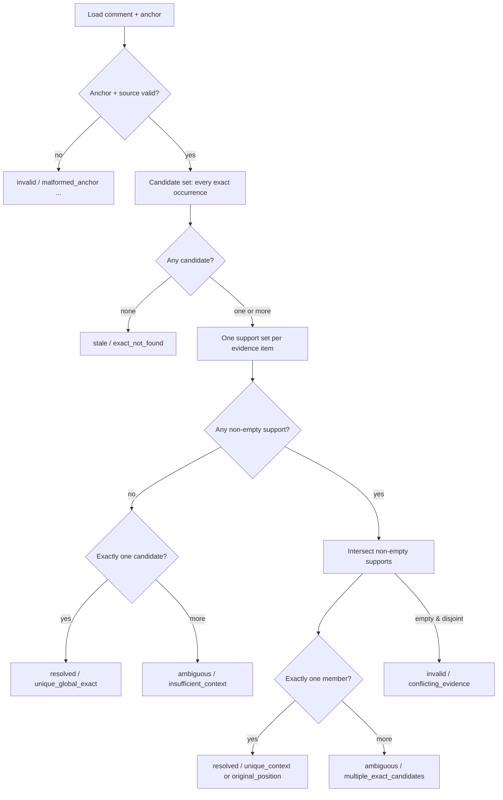

# Annotations v2: a hands-on Studio walkthrough

This page exists to be **used**, not just read.
Everything below is a real action you perform in the running okf-loom
Studio against this very bundle — no mockups, no fake status badges,
no decorative screenshots.
By the end you will have selected text, posted a comment, watched an
agent resolve it, re-anchored a comment to new wording, searched six
ways, and pulled a deterministic, citation-ready Context Pack.

> **See it live.** If a Studio is not already open, start one and keep
> it in a tab next to this walkthrough.

```bash
scripts/okf-loom serve docs-bundle --no-open   # http://127.0.0.1:8787/
```

Then open **this page** in the Studio, select any sentence, and watch
a *Comment* button appear.
> The graph icon in the top bar shows how this page links into the rest
> of the bundle.

The authoritative contract for everything here is
[spec §12.1 — Annotations v2 contract](/reference/spec.md#121-annotations-v2-contract-normative-implemented).
This walkthrough is the hands-on version of that contract.

## Start here

Five minutes, one open tab.

1. Open this page in the Studio (`/demo/annotations_v2_showcase`).
2. Select the fixture sentence in [The anchor health gallery](#the-anchor-health-gallery) below — a *Comment* button appears over your selection.
3. Type the comment prompt from [Add a comment, then resolve it](#add-a-comment-then-resolve-it) and post it.
4. Watch the agent (or you, via the CLI) claim, edit, and resolve it — the card updates live without a reload.
5. Re-anchor that comment to the replacement passage in [Re-anchor a moved target](#re-anchor-a-moved-target).

You will prove six things, in order:

1. **Anchor health** — a real comment lands as *resolved*, not "first match".
2. **Comments + resolution** — the user-directs / agent-authors loop closes.
3. **Re-anchor** — a comment follows its target to new wording.
4. **Six-mode search** — one box, six ranking modes.
5. **Deterministic Context Packs** — cited evidence, no database.
6. **Live updates + undo** — edits patch in place; history rolls back.

## Before vs Annotations v2

The old anchor model was *first-match*: the first place some text
appeared won, even if it appeared ten times and the reader meant the
seventh.
That made comments fragile — edit a heading or move a paragraph and the
highlight silently jumped to a different occurrence, or vanished.

Annotations v2 replaces that with a **candidate-set resolver**.
It enumerates *every* exact, code-point-aligned occurrence of the
selected text, then intersects independent evidence (original position,
stored block, block hash, heading path, adjacent prefix/suffix) in one
commutative, order-independent step.
Nothing is "first", nothing is fuzzy, and nothing is guessed
(see [spec §12.1](/reference/spec.md#121-annotations-v2-contract-normative-implemented)).

| Concern | Legacy anchors | Annotations v2 |
| :--- | :--- | :--- |
| Match strategy | First occurrence wins. | Full candidate set; commutative intersection of evidence. |
| Multiple identical occurrences | Silently picks the first. | Resolves only when evidence uniquely identifies one; otherwise `ambiguous`. |
| Edit resilience | Highlight can jump or vanish. | Reports `position_moved` / `block_moved` / `heading_changed` and still resolves when unique. |
| Anchor stored as | `{kind:"text", ref:"…"}` (unique-only). | Closed v2 schema: `exact` + bounded `prefix`/`suffix` + `heading` + `block` + `position`. |
| Resolver output | Resolved or not. | Four-way: `resolved`, `stale`, `ambiguous`, `invalid` — each with typed reasons. |
| Versioning | None. | `anchor.schema: 2`, `resolver_version: 2`. |

The fixture sentence you will use for the exercises is intentionally
boring and unambiguous — that is the point (it is the one plain
paragraph set off immediately below):

The river path stays open after sunset when the amber markers are visible.

It appears **exactly once** on this page, so the resolver has exactly
one candidate for it: a clean `resolved / unique_global_exact`.

## The anchor health gallery

Every comment carries a derived **anchor health**, independent of its
lifecycle state (`open` / `claimed` / `resolved` / `dismissed`) and its
archive flag.
Only a uniquely `resolved` anchor may create a highlight or enable
*Jump*; any other result removes the mark
([spec §12.1](/reference/spec.md#121-annotations-v2-contract-normative-implemented)).

The resolver produces exactly one of four statuses, each with typed
reasons.

This flow is what runs when a comment loads (described in prose, then
diagrammed):

> The resolver validates the anchor and canonical source, extracts all
> v2 blocks, enumerates the full candidate set for `exact`, computes
> one support set per evidence item, intersects the non-empty supports,
> and returns a revision-qualified status with an ordered `changes`
> list.



Here is what each status means and how to see it live, truthfully —
**without** fabricating a badge on this page.

### `resolved` — do this now

Select the fixture sentence — the single plain paragraph directly above this
gallery, under *Before vs Annotations v2* — and post a comment with the
prompt from the next section.
The card lands **resolved**, a highlight appears on the sentence, and
the *Jump* control is enabled.
Allowed reasons: `original_position`, `unique_context`,
`unique_global_exact`.

### `stale` — when the text is gone

`stale` means `exact` no longer occurs anywhere in the canonical page
(reasons: `exact_not_found`, `no_compatible_candidate`).
The highlight is removed and *Jump* is disabled, but the comment body
and lifecycle are untouched — resolution is a derived projection, never
stored truth.
See [Re-anchor a moved target](#re-anchor-a-moved-target) for the
honest way to produce this.

### `ambiguous` — when evidence can't pick one

`ambiguous` means `exact` occurs more than once and the evidence does
not uniquely identify a single occurrence (reasons:
`multiple_exact_candidates`, `insufficient_context`).
To see it: post a comment on a word that repeats across this page
(for example "comment") — the resolver will report the candidate count
and refuse to guess.

### `invalid` — when the anchor itself is broken

`invalid` means the anchor or its source mapping is malformed (reasons:
`malformed_anchor`, `unsupported_schema`, `invalid_offsets`,
`oversized_anchor`, `source_mapping_failed`, `conflicting_evidence`).
This is a resolver outcome, not an HTTP failure: the request still
succeeds, the comment is still stored, it simply has no highlight.
Public input is a closed schema, so the normal way to reach `invalid`
is a corrupt stored row, which the fail-closed reader surfaces rather
than silently "fixes".

## Add a comment, then resolve it

Comments are the user-directs / agent-authors loop: you direct by
selecting text and commenting; the agent consumes with
[`scripts/okf-loom wait`](/reference/cli.md) and closes the loop with
`comment-resolve`.
Full state model in
[Comment lifecycle and archive rules](/reference/comment_lifecycle.md).

The comment prompt to paste:

> Does the after-sunset closure rule still hold once the amber
> wayfinding markers replace the old ones?

Hands-on, on this page:

1. Select the fixture sentence in the gallery above.
2. Open the *Comment* box over your selection, paste the prompt above, and post it; the card appears with `state: open` and `anchor_resolution: resolved`.
3. Claim it on the agent side, then resolve it (commands below).
4. Watch the card flip from `open` → `claimed` → `resolved` **live**, with no reload — that is the SSE event stream doing its job.

Claim it (agent side):

```bash
scripts/okf-loom comment-claim docs-bundle <id> \
  --summary "ask: confirm dusk rule under new wayfinding"
```

Resolve it:

```bash
scripts/okf-loom comment-resolve docs-bundle <id> \
  --reply "Confirmed — the rule holds; anchor will follow the dusk wording." \
  --summary "done: rule confirmed; anchor tracks updated wording"
```

That `--summary` is the short **done** blurb shown in the collapsed
thread preview; `--reply` is the long-form message readers expand.

> **Archive is a separate track.** Archiving a resolved thread keeps it
> resolved; it is a soft hide, not a lifecycle state.
> The server enforces whole-thread-resolved before archiving, so a
> hand-crafted POST cannot bypass it.

## Re-anchor a moved target

When the text a comment points at moves or changes wording, you do not
delete the comment — you **re-anchor** it.
Re-anchor (`POST /__comment-reanchor`) is a closed-schema, idempotent,
crash-consistent operation that swaps only the `anchor` field: it
preserves lifecycle, body, archive, Markdown undo history, and every
unknown stored field
([HTTP routes — `/__comment-reanchor`](/reference/http_routes.md#comment-reanchor)).

The replacement passage below is the target you will re-anchor **to**.
It appears exactly once on this page, so it is a clean, unique v2
target (the one plain paragraph set off immediately below):

The riverside path remains open after dusk when amber wayfinding markers can be seen.

Hands-on re-anchor on a *fresh* anchor:

1. You already have a `resolved` comment on the fixture sentence.
2. Select the replacement passage above and choose **Re-anchor**.
3. The Studio posts a v2 anchor for the new wording under the comment lock, validates it against the current canonical page, and appends one full row with a fresh `row_token`.
4. The highlight moves to the replacement passage; the comment body and `resolved` state are unchanged.

### Why this page does not ship a pre-seeded *stale* fixture

A persistent, ready-to-view *stale* comment would require the fixture
sentence to be **removed** from this canonical page (the only supported
way to make an anchor genuinely stale is for its `exact` text to no
longer occur in the canonical source — there is no "mark stale" API).
That would break the "exactly once" fixture every reader needs for the
*resolved* exercise, and would mutate canonical documentation — which
this showcase refuses to do.

The honest way to observe `stale` live is transient:

1. Post a comment on the fixture sentence (it lands `resolved`).
2. In **Source** view, or via an agent edit, change that sentence to read exactly like the replacement passage above.
3. Save; the comment card flips to `stale / exact_not_found`, the highlight disappears, and the **Re-anchor** control becomes the offered recovery.
4. Re-anchor to the new wording (or undo the edit to restore the fixture).

The **Re-anchor** control uses the same `POST /__comment-reanchor`
route, v2 validation, and row-token/content-revision CAS documented in
[HTTP routes — `/__comment-reanchor`](/reference/http_routes.md#comment-reanchor):
it swaps only the `anchor` field and preserves lifecycle, body, archive,
and Markdown undo history.
Try it on the comment you created in the previous section.

## The wider workflow (also new in this build)

Annotations v2 is the headline, but the same Studio ships the rest of
the v2 surface.
Each is a real control you can poke at on this bundle.

### Six-mode search

One search box (`Ctrl+K` / `⌘K`, or the *Commands* button) dispatches
to **six** ranking modes behind a single switch.
All six are dependency-free out of the box — no embedding service, no
vector index
([Search modes](/reference/search_modes.md)).

| Mode | Ranks by | Try it on this bundle |
| :--- | :--- | :--- |
| `lexical` (default) | Field-weighted BM25 (title 5× > headings 3× > …). | Search "anchor". |
| `tag` | Tag membership, ties by title. | Search "demo". |
| `semantic` | Fuzzy-semantic token + char-trigram cosine (not embeddings). | Search "comment follows its target". |
| `hybrid` | Reciprocal Rank Fusion (k=60) of lexical ∪ semantic. | Search "stale re-anchor". |
| `entity` | Matches id/title/description/entity labels/aliases. | Search "Re-anchor". |
| `relation` | Filters typed-relation + markdown graph edges. | Filter by source `demo/annotations_v2_showcase`. |

Every mode is **deterministic**: the same `(bundle, query)` always
yields the same ordering, tie-broken by concept id.

### Deterministic Agent Context Packs

Need cited evidence for an agent, without a database, vector store,
embedding model, or LLM?
[Context Packs](/reference/context_packs.md) are a read-only,
deterministic, citation-ready projection over one immutable bundle
snapshot.

```bash
scripts/okf-loom context docs-bundle "re-anchor stale anchor" \
    --mode hybrid --budget-tokens 6000 --neighbors 1 --limit 20 \
    --format markdown
```

Each excerpt carries an exact `[path.md#Lx-Ly]` citation.
Preserve those citations: retrieval is deterministic and uses no model.

### Live updates

Edit any concept on disk (or via a mutator) and the open page **patches
in place** — scroll position, selection, and drafts survive.
The graph is alive too: add a concept and watch it fade into the
canvas with a "Graph updated" chip.
On the graph, click one node then shift-click another to trace the
chain between them.

### Undo

Markdown edits enter undo history; re-anchor deliberately does **not**
(it owns only the anchor, never the document).
Undo rolls the page back to a prior canonical revision and the resolver
recomputes anchor health against the restored bytes — stored anchor
intent is preserved, resolution is rederived.

### What is deliberately not here yet

**Proposal/Diff Review** remains deferred in this build.
It is referenced honestly so readers know the surface exists, but no
control for it ships on this page or in this Studio.

## Success checklist

Work through this in the Studio — each numbered step is something you
do and confirm, in order.

1. Opened this page in the Studio and saw the governed frontmatter band (type, aliases, entity chips, relations, provenance, citations) render above the body.
2. Selected the fixture sentence and saw the *Comment* button.
3. Posted the comment prompt; card landed `resolved`.
4. Ran the claim → resolve loop; card updated live, no reload.
5. Re-anchored the comment to the replacement passage; highlight moved, body and state unchanged.
6. Searched six modes from one box; ordering was deterministic.
7. Pulled a Context Pack and saw `[path#Lx-Ly]` citations.
8. Edited a concept on disk and watched the open page patch in place.
9. Opened the graph (`/__graph`) and found this node linked to spec, comment lifecycle, search modes, context packs, and the render showcase.
10. Reached this page from the homepage's *See v2 in action* link.

## Canonical references

- [Spec §12.1 — Annotations v2 contract](/reference/spec.md#121-annotations-v2-contract-normative-implemented) — the normative, implemented contract.
- [Comment lifecycle and archive rules](/reference/comment_lifecycle.md) — states, archive track, threading, JSON shape.
- [`/__comment-reanchor` HTTP route](/reference/http_routes.md#comment-reanchor) — closed schema, idempotency, WAL, error envelope.
- [Search modes](/reference/search_modes.md) — the six modes behind one flag.
- [Agent Context Packs](/reference/context_packs.md) — deterministic, cited, read-only.
- [Direct the agent loop](/tutorials/author_with_agent.md) — wait → claim → reply → resolve.
- [Why the live studio exists](/explanation/live_studio_design.md) — archive-as-a-track rationale.
- [What changed in okf-loom v2](/explanation/v2_release_notes.md) — the honest one-page summary of what shipped (timeline, old-vs-new, proof status, deferred work).
- [Rendering & Feature Showcase](/demo/showcase.md) — every renderer on one page (the companion demo).
