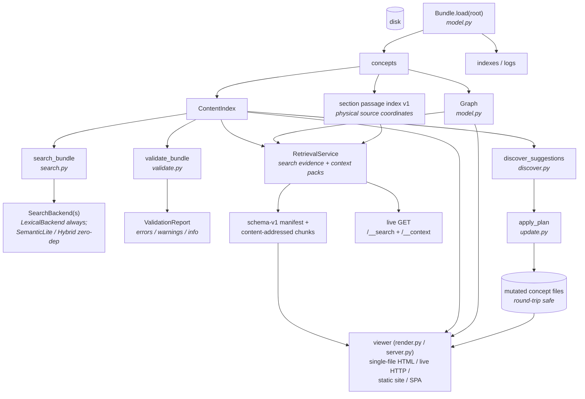
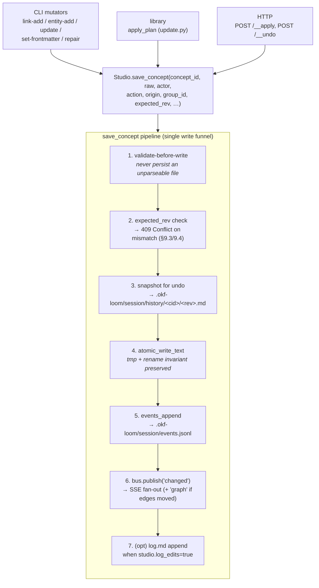
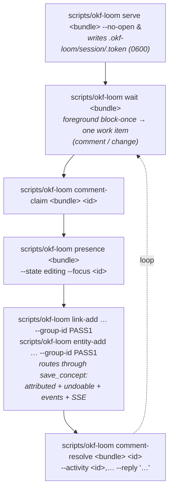

# Architecture

This document is the developer-facing reference for okf-loom: the
module map, the data flow, the extension points, the forward-compatibility
mechanisms, and the rationale. For best-of-breed research see
[`research.md`](/explanation/research.md); for harness-specific wiring see
[`embedding-guide.md`](/reference/embedding_guide.md).

## Design philosophy (in one paragraph)

OKF is intentionally minimal (upstream 0.2 §11). okf-loom mirrors that
philosophy: it is **permissive** (load never hard-fails on soft issues),
**layered** (cheap core, optional extras), and **single-source-of-truth**
(canonical Markdown loaded into one `Bundle`, with rebuildable derived
views). It is
**harness-agnostic** (no opinion on which agent framework consumes it)
and **forward-compatible** (a capability registry lets bundles opt into
optional extensions without spec changes). It is **dependency-light by
default** (PyYAML is preferred when present, with a conservative built-in fallback) so the same checkout runtime
runs in a CI runner, a meta-agent's subprocess, or an air-gapped
notebook.

## Module map

```
scripts/okf_loom/
├── __init__.py        — public API + versioning constants (SPEC_VERSION, RESERVED_FILENAMES, …)
├── __main__.py        — module entry used by the `scripts/okf-loom` helper
├── exceptions.py      — OKFError hierarchy
├── paths.py           — ConceptId = tuple[str,...]; segment validation; path<->id; reserved-name check; path_within_bundle symlink-containment guard
├── parse.py           — frontmatter parse + serialize; link extraction (BOTH forms + wikilinks); markdown->text
├── model.py           — Bundle, Concept, IndexFile, LogFile, Link, Graph, ContentIndex, Heading; has_wikilinks
├── ignore.py          — gitignore-style exclusion for bundle scanning (stdlib-only leaf): default excludes (hidden dirs, node_modules, nested git repos), .gitignore respect, bundle.exclude patterns, bundle.include add-backs (revive/reach/force semantics); iter_markdown_files pruning walker used by Bundle.load / serve watcher / import
├── metadata.py        — read-only OKF 0.2 normalization, aware timestamps, source signals, advisory trust/lifecycle, soft family diagnostics
├── upgrade.py         — read-only plans and explicit additive per-file migration; declaration last
├── validate.py        — upstream §11 conformance + warnings; CheckSpec; ValidationReport (with profile); Finding
├── search.py          — SearchBackend Protocol; LexicalBackend (BM25) + SemanticLiteBackend + HybridBackend (RRF, all zero-dep); ENTITY/RELATION modes
├── retrieval.py       — RetrievalService; schema-v1 section passage index; physical source coordinates; bounded search evidence/context packs; portable corpus build + validation
├── discover.py        — 6 discovery rules; Suggestion; DiscoveryReport
├── plan.py            — PlannedAction/Plan; executable action-envelope planner (discovery + index staleness + relation mirroring)
├── update.py          — UpdatePlan/UpdateOp; 8 idempotent op kinds (incl. add_entity); safe round-trip via parse/serialize; accepts studio/actor/origin/group_id and threads them through every concept write (single-funnel attribution)
├── index.py           — upstream §8 index.md regeneration; marker-safe; frozen CI mode; current spec §8 derived artifacts (emit_json)
├── log.py             — upstream §9 log.md append-only helper
├── config.py          — okf-loom.config.yaml loader (bundle/viewer/search/validate/studio defaults); fail-closed bool + enum validation
├── bootstrap.py       — init / bootstrap / import scaffolding
├── extensions.py      — CapabilityRegistry + 25 built-in okf.cap.* capabilities (incl. aliases/provenance/citations/wikilinks/search_hybrid)
├── cli.py             — argparse dispatcher (one cmd_* function per subcommand); includes wait, token, comment-claim, comment-resolve, comment-list, presence; mutators carry --group-id / --actor and route through the live studio funnel when a session exists
├── render.py          — render_single_file + build_site (spa/static/single-file); emits validated passage manifests/chunks and canonical concept context
├── export_ownership.py — opt-in managed static/SPA output: closed .okf-export.json manifest, no-follow tree walker, preflight / locked / quarantined ownership checks
├── annotations.py     — Annotations v2 block extraction, closed public anchor validation, capture, and order-independent resolution
├── server.py          — live HTTP wiki server (stdlib only); read-only /__search + /__context; bounded retrieval executor; mtime watcher; studio GET/POST routes; CSRF + Origin/Host controls on mutation
├── studio.py          — studio core: EventBus (subscribe/publish), Studio (single write funnel save_concept), presence, comments (claim/resolve), undo + group-undo, events.jsonl rotation, cross-process dedup; current spec §10-§13 library API (save_concept, post_presence, post_comment, resolve_comment, record_activity, events_append, post_suggestion)
├── watch.py           — scripts/okf-loom watch headless change feed (reuses _BundleWatcher)
└── viewer/
    ├── __init__.py    — lazy public re-exports
    ├── assets.py      — template/static/config/palette loaders (4 override points); two-layer active-code gate
    ├── markdown.py    — small stdlib Markdown renderer + internal-link rewriter
    ├── plugins.py     — entry-point ViewerPlugin loader (group okf_loom.viewer_plugins); CompositeViewerPlugin
    ├── OVERRIDES.md   — concrete examples of every override point
    ├── templates/     — single_file.html, concept_page.html, index_page.html, search_page.html, graph_page.html
    └── static/        — wiki/graph/live/studio assets; portable-retrieval.js validates and queries the portable corpus; static-search.js and single-search.js adapt it to portable targets; renderers.js adds optional rich rendering
```

## Session and proposal ownership

Canonical authored content remains Markdown; collaboration has separate
versioned state, not merely rebuildable retrieval indexes.

| Owner | Boundary and focused test seams |
|---|---|
| `session_authority.py::SessionAuthority` | Pins session directories with descriptors and validates private ownership/containment. Studio and proposal stores share this authority rather than trusting mutable pathnames. External roots use `OKF_LOOM_SESSION_ROOT` and the trusted-root rules. Lifecycle/substitution seams: `tests/test_capture_ui_overhaul.py`, `tests/test_proposal_activation.py`. |
| `studio.py`, `directive_store.py`, `presence.py` | Studio owns direct writes, session lifecycle, events and undo; directive transactions/checkpoints own comment recovery; presence owns its bounded state. Direct-write coverage: `tests/test_studio_iter1_backend.py`, `tests/test_mutation_contracts.py`. |
| `proposal_review/activation.py`, `http.py`, `cli_adapter.py` | Explicit experimental activation and transport adapters; HTTP routes are under `/__proposal/v1/`. Tests: `tests/test_proposal_activation.py`, `tests/test_proposal_http.py`, `tests/test_proposal_cli.py`. |
| `proposal_review/service.py`, `repository.py`, `transactions.py`, `publication.py` | Transport-neutral operations, durable repository/recovery, transaction finalization and publication. Tests: `tests/test_proposal_apply.py`, `tests/test_proposal_repository.py`, `tests/test_proposal_crash.py`. |
| `proposal_snapshot.py`, `proposal_runtime_identity.py` | Snapshot isolation and reviewed execution identity. Tests: `tests/test_proposal_capture_preview.py`, `tests/test_proposal_runtime_identity.py`. |

The backend/CLI/HTTP proposal capability exists experimentally. Studio adds an
opt-in, local, inspection-only Proposals panel (`viewer/static/studio.js`; proof
`tests/test_proposal_inspection_browser.py`); the browser decision and apply
workflow is incomplete and unexposed. Direct mode remains default.
See the [proposal extension](/reference/proposal_diff_review.md) for its contract,
not the historical retrieval roadmap. The
[maintenance plan](/explanation/maintenance_plan.md) owns current priorities.

## Data flow



Three properties fall out of this:

1. **Cheap to load.** `Bundle.load` parses frontmatter and headings; it
   does not build the graph or the content index. Those are computed
   lazily and memoized on the Bundle instance (`bundle.graph()`,
   `bundle.content_index()`).
2. **One canonical source, several derived views.** Markdown, indexes, and
   logs loaded into a `Bundle` are authoritative. `ContentIndex`, `Graph`,
   search backends, bundle revision, and the schema-versioned section passage
    index are immutable, rebuildable views of that snapshot. There is no
    parallel source of truth. Portable JavaScript independently implements the
    bounded retrieval contract over the normalized, revision-bound corpus;
    cross-runtime parity and fail-closed validation tests keep it aligned with
    the Python service.
3. **Mutations are round-trip.** Every writer (update.py, index.py,
   log.py) goes through `parse_document → modify → serialize_document`
   so unknown frontmatter keys and key order are preserved.

## Retrieval and context seam

`RetrievalService` is the public read-only seam over one `Bundle` snapshot.
It combines concept ranking from `search.py` with a section passage index
derived from canonical Markdown and graph evidence derived from `Graph`.
Search results retain the established result fields and add bounded reasons,
backends, relation evidence, and an exact passage when one exists. Context
packs use the same ranking and passage records, so their JSON and Markdown
representations select the same items.

Passage coordinates are source coordinates, not rendered-page positions.
`path` is a canonical bundle-relative `.md` path; `line_start` and `line_end`
are 1-based absolute physical lines and therefore count YAML delimiters,
frontmatter, headings, and blank lines. Normal section excerpts exclude the
heading itself, while a heading-only section may cite the heading line.
Long physical lines split deterministically and carry character offsets.
LF and CRLF produce the same line coordinates, the final unterminated line
counts, and heading-like text inside a fence is not treated as a heading.

Derived state belongs to the `Bundle`. Its re-entrant derived-state lock
single-flights publication of `ContentIndex`, `Graph`, lexical and
SemanticLite backends, passage index, capabilities, and revision.
`Bundle.invalidate()` clears all of them after supported in-memory mutation;
`Bundle.reload()` replaces canonical loaded state and clears them coherently.
Its scan/publication boundary is generation-CAS owned: a concurrent mutation
or failed transaction rollback invalidates a scan (including temporary bytes),
which is discarded and retried rather than published as retained state.
The live server instead swaps a fresh `Bundle` under its state lock. Each
retrieval handler captures that pointer once, so an in-flight request may
finish on revision A after the server activates revision B, but its evidence,
rendering, `ETag`, and `X-OKF-Bundle-Revision` all remain revision A.

Live retrieval is admitted through a bounded executor (four workers by
default) with one absolute 30-second deadline spanning compute, bounding,
serialization/rendering, encoding, and the final response cap. Saturation and
deadline expiry fail with a typed `503`; timed-out work keeps its admission
slot until it actually exits, while cooperative cancellation prevents an
aborted cold index from being published. Search, context, and hybrid
capability checks do not mutate bundle or capability state. Payload and
revision headers come from the same locked snapshot operation.

See [Context packs](/reference/context_packs.md) for the emitted schema,
[Search modes](/reference/search_modes.md) for ranking behavior, and
[HTTP routes](/reference/http_routes.md) for the public request contract.

## Portable retrieval artifacts

Static and SPA builds write a fixed-name schema-v1 manifest plus immutable,
content-addressed passage chunks. Manifest descriptors and chunks bind the
schema, algorithm, bundle revision, sequence, count, identity, and SHA-256
content hash. A consumer validates the complete set, canonical passage
coordinates, ordering, graph data, and revision before publishing any corpus;
partial, mixed, duplicated, unsupported, or tampered artifacts fail closed.
The mutable manifest is revalidated while hash-named chunks may be cached as
immutable. Producer and all portable consumers enforce the same 16 MiB
manifest cap. Caller-owned earlier deadlines are preserved, and BFCache
restoration starts a fresh validation generation rather than reusing an
aborted provider.

Imported-corpus validation additionally maintains corpus-wide canonical-byte
and recursive projection-work counters across every chunk. Bounds and
cancellation are checked before monolithic encoding; projection keys are
bounded by characters and UTF-8 bytes; chunk indexes must be canonical
integers. Over-budget, cancelled, mixed-index, or malformed input fails closed
without a partial corpus.
Canonical JSON and recursive passage projections also reject lone Unicode
surrogates with stable typed contract errors. Cancellation is checked before
passage encoding, so neither invalid Unicode nor cancellation leaks partial
corpus state.
The imported artifact has an exact top-level schema, and full passage ordering
uses the complete canonical tuple; extra/missing top-level fields or reversed
distinct same-prefix passages fail closed even if hashes are recomputed.

Static and SPA search pages load that corpus on demand rather than making
ordinary pages preload it. The single-file target embeds the same normalized
corpus because it has no network seam. With JavaScript, static, SPA, and
single-file targets run the practical six modes and prepare bounded context
locally. Static no-JavaScript output intentionally does not claim arbitrary
search: authored type/tag browsing and per-concept canonical Markdown context
remain available. Live no-JavaScript uses the complete server-rendered GET
flow.

## Extension points (five)

okf-loom is extensible without forking. The five override surfaces:

1. **Capability registry** (`extensions.py`). 25 built-in `okf.cap.*`
   capabilities (core/recommended/optional tiers), including the
   governed-key caps (`aliases`, `provenance`, `citations`, `entities`) and
   `wikilinks`/`search_hybrid` (`wikilinks` activates on `[[…]]` use;
   built-in dependency-free hybrid support is statically derived). Bundles opt in via `okf_extensions:` in root `index.md`
   frontmatter or by using the governed keys (auto-activation). Plugins add
   capabilities at import time via `default_registry().register(Capability(...))`.
2. **Search backends** (`search.py`). `SearchBackend` Protocol. The
   `LexicalBackend` (BM25), `SemanticLiteBackend` (trigram+token TF cosine),
   and `HybridBackend` (RRF fusion of the two) all ship dependency-free.
   There is no local embedding backend: the agent (an LLM in opencode /
   Claude Code / Codex) is itself the best true-semantic engine, so a
   dense/vector backend would be redundant. The CLI `--mode` flag
   dispatches to the matching backend.
3. **Viewer template / static / config overrides**
   (`viewer/assets.py`). A bundle drops files under
   `.okf-loom/viewer/{templates,static}/` or `.okf-loom/viewer/config.json`
   to customise rendering. Executable overrides require the active-code gate.
   Type-colour overrides in `.okf-loom/viewer/palette.json` are retired:
   compatibility data may still be loaded, but Ledger ignores it when painting
   types and graph nodes. See `viewer/OVERRIDES.md`.
4. **ViewerPlugin hook** (`viewer/plugins.py`, current spec §15).
   `on_concept_render(concept, html) -> html` (plus optional
   `on_index_render`). Plugins are discovered via the
   `okf_loom.viewer_plugins` entry-point group and called in registration
   order; raising plugins are logged and skipped. The two-layer active-code
   gate (bundle `viewer.allow_active_code` AND operator `--allow-active-code`
   / `OKF_LOOM_ALLOW_ACTIVE_CODE`) governs whether discovery runs at all. See
   `viewer/OVERRIDES.md` §5.
5. **Discovery rules** (`discover.py`). The six built-in rules
   (`unlinked_mentions`, `missing_indexes`, `missing_descriptions`,
   `broken_links`, `missing_relations_hint`, `orphan_concepts`) are
   module-level functions taking a `Bundle` and returning
   `list[Suggestion]`. Adding a rule = adding a function and a key in
   the `_RULES` registry.

## Forward compatibility

okf-loom must stay correct as OKF evolves beyond 0.2 and
let bundles extend without breaking. Four mechanisms:

1. **Spec-version tracking.** `SPEC_VERSION = "0.2"` is the single
   constant. On load, the bundle's declared `okf_version` is read; if it
   differs okf-loom does best-effort consumption (upstream 0.2 §12).
   The validator's `spec_version_check` warns for malformed/newer-minor/
   different-major declarations; older minors and absence are informational.
2. **Capability registry.** Optional behaviors live behind named
   capabilities (`okf.cap.typed_relations`, `okf.cap.entities`,
   `okf.cap.aliases`, `okf.cap.provenance`, `okf.cap.citations`,
   `okf.cap.wikilinks`, `okf.cap.search_hybrid`, `okf.cap.embeddings`,
   `okf.cap.discovery_ner`, `okf.cap.diataxis_types`,
   `okf.cap.jsonld_export`, `okf.cap.multi_bundle`, … — 25 built-in total).
   They are recognised-if-present, never required. `okf.cap.wikilinks`
   auto-activates on `[[…]]` body syntax (`bundle.has_wikilinks`);
   `okf.cap.search_hybrid` is statically supported by the built-in
   dependency-free backend; retrieval reads never activate capabilities. The
   rest activate on their governed frontmatter keys. User-defined capabilities use
   a custom namespace (`acme.x`) and a JSON-schema fragment for the keys
   they introduce.
3. **Conservative opt-in migration.** `upgrade.py` plans 0.1 → 0.2 changes without
   writes; only `--apply` writes. Explicit original-producer attribution,
   optional preview CAS, per-file atomicity, root-last ordering, and forward
   rerun protect legacy evidence. Partial reports can succeed. See the
   [migration procedure](/how-to/migrate_spec_version.md).
4. **Safe auto-update of bundle structure.** `index.md` regeneration
   skips hand-authored files (or rewrites only inside
   `<!-- okf:generated:index begin/end -->` markers, or replaces files
   with literal boolean `generated: true` root frontmatter). A concept generation
   mapping never grants index ownership. `log.md` updates are always
   append-only. Discovery finds gaps and emits a structured plan; the agent that
   manages the bundle applies its edits directly through the mutators (the CLI
   also offers a reviewable-plan workflow, but `apply_plan` itself never auto-runs
   from inside discovery — it is always called explicitly by the agent or user).
   A `--frozen` mode for CI fails loudly rather than
   writing to hand-authored files.

## Performance characteristics

- **Load and derived state.** `Bundle.load` is O(N) over files. Graph,
  `ContentIndex`, search backends, passage records, and revision are lazy and
  memoized on the immutable snapshot; invalidation or a fresh snapshot rebuilds
  them.
- **Retrieval.** Ranking and passage selection scan in-memory derived data.
  Aggregate concept, passage, and source-codepoint work caps fail closed, and
  public requests also have concurrency and deadline bounds. These controls
  are safety limits, not scale promises.
- **Portable output has an intentional time/size cost.** In the audited
  deterministic static-build harness (build only, excluding `Bundle.load`),
  the completed retrieval tranche measured 133.541787 ms and 2,149,088 bytes
  for 100 concepts, versus the comparable baseline's 92.255596 ms and
  1,676,433 bytes. At 1,000 concepts it measured 2,945.275413 ms and
  15,019,571 bytes, versus 2,038.156329 ms and 11,296,537 bytes. That is
  +44.75% time/+28.19% size at 100 and +44.51%/+32.96% at 1,000. The
  post-tranche runs used one sample; do not treat them as broad performance
  guarantees. A later current-only 10,000 static run measured 358,417.871 ms,
  143,736,917 bytes, and 20,058 files; it is not a before/after comparison.
  No current 50,000 static run was started because the baseline exceeded 2.5
  hours.
- **Writes.** Runtime writes remain atomic (`tmp` + `os.replace`); portable
  output is derived and rebuildable rather than a mutable source database.

## The live collaborative studio layer

`scripts/okf-loom serve` runs a **live collaborative studio**: the user reads
and **directs via comments**; an **external agent authors** the OKF files in
real time through the same mutators it always uses. Every change appears
live, in place, with no full-page refresh. The full current design lives in
[`spec.md`](/reference/spec.md); this section is the developer map. Three
new modules (`studio.py`, `watch.py`, plus extensions to `server.py` /
`cli.py` / `update.py`) carry it; the wire format is OKF 0.2 with legacy compatibility.

### Studio layer — `studio.py`

Two classes carry the in-process studio:

- **`EventBus`** — thread-safe fan-out. Each subscriber gets a bounded
  `queue.Queue` (default 64); `publish(event)` enqueues to every
  subscriber in registration order; a slow subscriber drops deltas and
  gets one `resync` event so it never blocks the publisher. `subscribe()`
  takes an optional callback (the in-process embedding shape, §17) or
  returns the queue for the caller to poll. `client_count()` and
  `unsubscribe(sub)` manage lifecycle.
- **`Studio`** — the per-bundle studio handle. Constructed via
  `Studio.for_bundle(bundle_root, *, session_rel=".okf-loom/session",
  log_edits=True, bundle_name="", max_queue=64)`; `ensure_session()`
  creates the session dir + the per-session CSRF token (`.token`, 0600).

#### Single internal write funnel — `Studio.save_concept(...)`

`save_concept` is the **single internal atomic write path** every concept
write goes through, whoever the caller is:



Because every writer goes through the same funnel, **attribution is
exact** (`actor` + `origin`), **undo is always available** (snapshot +
optional group manifest under `.okf-loom/session/history/<group_id>/`), and
the **change list is complete** (one `events.jsonl` row per write). There
is no duplicated bookkeeping between the CLI and HTTP paths.

Cross-process per-target locks cover read, expected-revision comparison,
replacement, and conditional rollback for Studio, non-Studio, and index
writes. A post-content finalization envelope keeps undo snapshots,
`mark_logged`, group-manifest merge, activities, graph events, and change
events coherent; failed finalization restores only bytes still owned by that
transaction. Group manifests merge under a cross-process lock so concurrent
processes cannot lose members.

The transaction owner reserves group capacity before content mutation and
fails closed without rewriting malformed, wrong-shape, or unreadable
manifests. Sidecar compensation is record-specific: it cannot erase another
process's event, history snapshot, logged revision, or group membership.
Finalization retains and publishes its exact committed event records using
canonical dedup keys, including across event rotation and feeds larger than
1,000 rows.

The complete unique transaction member set is preflighted and capacity-
reserved before content mutation, including grouped index writes. Event keys
are registered before direct publication, and a durable cursor drains every
record across active and rotated feeds without a fixed tail-window loss.
Capacity uses the union of committed, reserved, and complete transaction
members. Locally appended events remain tail-ineligible until direct
publication visibility and canonical dedup registration are established.

`apply_plan` (update.py) accepts `studio` / `actor` / `origin` /
`group_id` and threads them through every op, so a multi-op pass is one
group-undoable unit. `_handle_apply` and `_handle_undo` in `server.py`
call `save_concept` / `restore_snapshot` directly — the HTTP layer stays
a thin wrapper over the same funnel (current spec §10/§13).

CLI mutators detect a live session via `_maybe_studio_for_bundle` and
route through `_studio_aware_apply`. **Without** a session (no
`.okf-loom/session/`) they fall back to the non-studio atomic write path —
same data-safety, but no attribution / undo / events / SSE.

### Session storage — `<bundle>/.okf-loom/session/`

The default session location is `<bundle>/.okf-loom/session/`, configurable via
`studio.session_dir`; explicit external session authority may relocate it.
Keep session state out of Git. It contains comments, recovery/idempotency
records, credentials, events, undo, and any experimental proposal repository,
not just disposable caches. Deleting it is not a routine cleanup recipe:
canonical Markdown and `log.md` remain, but collaboration and recovery state
can be lost.

| File / dir | Purpose | Lifetime |
|---|---|---|
| `events.jsonl` | The single change/event log (current spec §11/§13). One JSON-line event per write. Powers the change list, the SSE stream, and `scripts/okf-loom watch --since`. Rotates at the cap (default 8 MiB) to `events-YYYYMMDD-NN.jsonl`. | ephemeral |
| `directives.jsonl` | Append-only full comment rows. Latest row wins; each v2 write gets an opaque row token. Anchors are intent, while resolution is derived. | ephemeral |
| `directives-checkpoint.json` | Durable latest complete row per comment, written before generation pruning and merged by readers with retained JSONL. | ephemeral |
| `.comment-create-wal/` | Prepared/finalized create transactions with hard cap, tombstones, and bounded fail-closed tombstone filter. | ephemeral |
| `.comment-reanchor-wal/` | Prepared/finalized re-anchor transactions with the same cap/tombstone/filter retirement contract. | ephemeral |
| `.directive-transaction-results/` | Exact prepared/finalized outcomes independent of lifecycle rows and pruning; retired only after WAL/tombstone retirement is durable. | ephemeral |
| `.notification-receipts/` | Pending/committed notification outbox for keyed/keyless create and re-anchor. Session then receipt directories are pinned with no-follow descriptors; one receipt dirfd owns enumeration through reconciliation and cleanup; constrained temp residue is recovered; legacy incomplete checkpoints fail closed. | ephemeral |
| `presence.json` | Agent presence (current spec §12): `{actor, state, focus, ts}`. State ∈ `idle`/`watching`/`thinking`/`editing`. | ephemeral |
| `.token` | Per-session CSRF token (`X-OKF-Token`), written 0600 on `scripts/okf-loom serve` boot. Read by `scripts/okf-loom token` and attached by the studio's own JS. | per-session |
| `.last-logged.json` | Cross-process dedup index (current spec §13). Maps the most-recent `rev` logged per concept so the watcher's disk-backfill never double-logs a write that already logged itself. | ephemeral |
| `history/` | Undo snapshots (current spec §13). `history/<cid>/<rev>.md` is a capped ring per concept; `history/<group_id>/` carries the group manifest for one-click group undo. | ephemeral |
| `_groups/` | Group-undo manifests (one per `--group-id` pass): the concept ids + revs to restore. | ephemeral |
| `proposals.jsonl` | **Only under a user's opt-in `propose_only` constraint** (current spec §10): the agent appends `PlannedAction` envelopes here for review. Absent by default. | ephemeral |

### Annotation projection and migration

Canonical Markdown bytes and the latest full directive row are the two
authorities. `annotations.py` derives `resolved`, `stale`, `ambiguous`, or
`invalid` health without persisting it. `render.py` emits the same
revision-qualified schema-1 source-to-DOM block map in initial concept HTML and
`/__data/doc`; `server.py` projects resolution into `/__comments`; and
`viewer/static/studio.js` commits marks only when concept id, content revision,
comment id, row token, and resolver version still match.

Initial `ready` reconciles unknown or stale SSR through a canonical fetch. Its
inventory is rebuilt from current contained resources, and polling shares SSE's
strict cursor/resync contract. Draft marks retain occurrence identity only for
the same content revision. The conflict dialog is the topmost keyboard owner,
and suggestions SSE has a production consumer.
Selection capture revalidates its live Range after any awaited canonical fetch,
and text-anchor submission requires an exact known draft/document revision.
Conflict refresh failure and overlapping modals are generation-owned; wide
comments use non-modal complementary rail semantics, narrow comments remain a
modal overlay, and BFCache restoration clears stale selection presentation.
Polling rejects malformed envelopes and cursor gaps remain uncommitted until
canonical resync. Every BFCache waiter remains pending until the latest queued
resync reaches terminal state before reconnect; suspension
invalidates in-flight resync and polling settlement is generation-bound.
Document/comment/event and re-anchor tuples discriminately validate every row
token, supported anchor kind, concept reference, event, resolution, and response
identity before any member commits. Inline
replies have request-specific abort/supersession ownership. SSE subscribes before
the replay snapshot and deduplicates overlap by high-water cursor.

Legacy `{kind:"text",ref}` rows remain read-only and resolve only when `ref` is
globally unique. Merely opening a bundle does not rewrite session history.
Explicit Re-anchor is the migration boundary: it captures schema 2, checks the
latest row token and content revision, and appends one full row through the
per-comment lock and crash-consistent WAL. SSE cursors notify the browser to
refetch canonical comment/document state; they are not comment versions.

`markdown_blocks.py` owns canonical block IR v1, the only grammar consumed by
extractor, renderer, and projection. Real renderer-owned nodes receive
pre-plugin capabilities; exact post-plugin finalization emits opaque numeric
keys and fails closed on altered ownership. Projection schema 1 exposes additive
`block_ir_version:1`. Finalization treats HTML5 tree-repair cases that cannot be
proven equivalent as incomplete, and any pre-existing projection key is forged
input rather than reusable ownership. Resolver v2 remains order-independent,
  with grammar fixes treated as conformance. Blockquotes recurse through the same canonical block grammar as rendering, and
  final leak guards reject residual owner/key capability text without rejecting
  clean authored text.
  Annotation mutation follows one global lock order: concept → idempotency key → comment → directives. Creation resolves the parent
and effective concept before validation, and finalized replay precedes current-
resource access.

### The agent loop (current spec §12)

The agent is the **processor**; it does not run a background daemon. The
canonical foreground loop:



`scripts/okf-loom wait --for comment` (default) blocks for the next `open` user
comment; `--for change` for proactive enrichment; `--for comment change`
for whichever arrives first. **Run it in the agent foreground** (you are
the processor); backgrounding it (`scripts/okf-loom wait &`) leaves returned work
unconsumed. `scripts/okf-loom watch` is the continuous-tail counterpart for piping
the feed to a long-running external consumer.

### Cross-process dedup model (current spec §13)

Several writers can mutate the bundle concurrently — the agent's CLI
mutator calls, `scripts/okf-loom watch --auto-repair`, the user editing files in
their own editor, and direct CLI. Each appends its own fully-attributed
event through one helper, `Studio.events_append(event)`, under a short
advisory file lock (`fcntl.flock` POSIX / `msvcrt.locking` Windows; the
fallback is a single-line `O_APPEND` write, which is atomic for small
records on POSIX). For changes that **weren't** logged by a studio
writer (the user's editor, any outside tool), the `_BundleWatcher`
detects the mtime change, diffs the `ContentIndex`, and appends an
`origin:"disk"` event; `.last-logged.json` de-dupes by `rev` so the
watcher never double-logs a write that already logged itself. The feed
is therefore complete regardless of which path produced the change.

### Trust model — single-user local admin (current spec §14)

The user is the admin and is **never gated**. The studio keeps exactly
the protections that cost the user zero friction and defend against
things that are not the user:

- **Loopback by default.** `scripts/okf-loom serve` binds `127.0.0.1`. Exposing the
  port to a network (`--public`, or a non-loopback `--host`) requires
  either `--public-ack` (non-interactive, CI) or an interactive `y/N`
  ack; the server refuses to start otherwise (exit 2). Closes the
  warn-only gap on a non-loopback bind (current spec §14).
- **Per-session CSRF token** (`X-OKF-Token`). Written to
  `.okf-loom/session/.token` (mode 0600) on boot, embedded in the served
  page, auto-attached by the studio's own JS to mutating requests. Read
  it with `scripts/okf-loom token <bundle>` when you must POST over HTTP directly.
- **Separated local/admin and public ingress.** Local POSTs require the admin
  token plus a non-empty allow-listed `Host`; when `Origin` is present it must
  also match `allowed_hosts` (default `[127.0.0.1, localhost]`; never empty).
  cloudflared targets a separate loopback listener carrying immutable listener
  identity and a generation capability, so spoofed `Host`, `CF-*`, and
  `X-Forwarded-*` headers cannot become local authority. Read-only public
  ingress receives no token. Explicit public edit receives a separate token
  scoped to comment/content mutation routes; admin, proposal, preview,
  presence, and sensitive diff routes remain local-only.
- **`--no-watch-ui` enforced server-side (current spec §11/§14).** When SSE / live UI is
  off, `/__events` returns `503` and the watcher is skipped entirely —
  not just hidden on the client.
- **`--no-edit` refuses POST operations at the route layer.** Live reads stay
  available; every POST, including comments, presence, preview, apply, and
  undo, returns `403`. `/__tunnel` alone remains available as server
  administration but still requires token and Host/Origin checks. For
  `/__comment-reanchor`, authentication and the authenticated rate-limit
  check run before the read-only check, matching the route's documented
  failure precedence.
- **Malicious-bundle code is still gated** behind the existing two-layer
  active-code gate (bundle `viewer.allow_active_code: true` AND operator
  `--allow-active-code` / `OKF_LOOM_ALLOW_ACTIVE_CODE`). Editing / saving /
  watching are explicitly **not** behind this gate.
- **Data-safety invariants** (correctness, not permission): validate
  before write (never persist an unparseable file), the `parse.py` /
  `markdown.py` DoS caps (including the nested-list recursion cap on
  `/__preview`), `paths.path_within_bundle` containment, atomic writes
  (tmp + rename), optimistic per-doc `rev`, and `/__apply` mapping ids →
  known `UpdateOp`s (never a shell/argv string). `rev` + `group_id` are
  validated against `_SAFE_PATH_TOKEN_RE` before any filesystem op under
  `history/` (§9.5).

**Summary:** the studio gates the port and the bundle's code, never the
user or their agent. The user's safety net for agent-authored edits is
the **live change list + (group) undo**, not an approval step.

### Conflict handling (§9.3 / §9.4)

Because the agent is the sole writer of `.md` files through the studio,
there is no user↔agent merge problem day-to-day. `rev = sha1(raw)[:12]`
per-doc keeps live updates coherent. The one real collision — the user
editing a file directly on disk at the same moment the agent writes it —
surfaces non-destructively: `POST /__apply` with a stale `expected_rev`
returns `409` with `{conflict, expected_rev, current_rev}` (no silent
clobber), and `GET /__diff?id=&from=&to=` returns a line diff for the
banner's "View diff" affordance.

## Test suite

- `tests/test_<module>.py` per source module.
- `tests/fixtures/{tiny_good,tiny_bad,empty_bundle}/` cover the format
  surface (both link forms, typed relations, generated index, log.md,
  missing-description case, broken-link case, malformed frontmatter).
- `tests/test_integration.py` runs full load → validate → discover →
  plan → apply → re-validate loops against the upstream
  `ga4`/`stackoverflow`/`crypto_bitcoin` bundles (marked
  `@pytest.mark.integration`).
- Run the suite: `cd okf-loom && python -m pytest`.
- Fast subset: `python -m pytest -m "not integration"` (≈1.5s).

## What okf-loom deliberately is NOT

- It is not a producer/enrichment agent. Upstream's `reference_agent`
  writes bundles by crawling BigQuery + the web; okf-loom consumes,
  validates, curates, and renders bundles produced by anyone.
- It is not a replacement for the upstream base wire-format spec.
  [`/reference/spec.md`](/reference/spec.md) governs current okf-loom behavior
  on top of upstream OKF SPEC 0.2.
- It is not a hosted service. The viewer is a static-site / live-dev
  server; it does not assume a database, an account system, or a network.
- It is not coupled to any specific agent framework. See
  `embedding_guide.md` for wiring recipes.

## References

- Current okf-loom spec: [`/reference/spec.md`](/reference/spec.md)
- Upstream base OKF SPEC 0.2: https://github.com/GoogleCloudPlatform/open-knowledge-format/blob/main/SPEC.md
- Upstream reference implementation: the upstream OKF SPEC repository (external)
- Best-of-breed research: `docs-bundle/explanation/research.md`
- Harness wiring: `docs-bundle/reference/embedding_guide.md`
- Override examples: `scripts/okf_loom/viewer/OVERRIDES.md`
